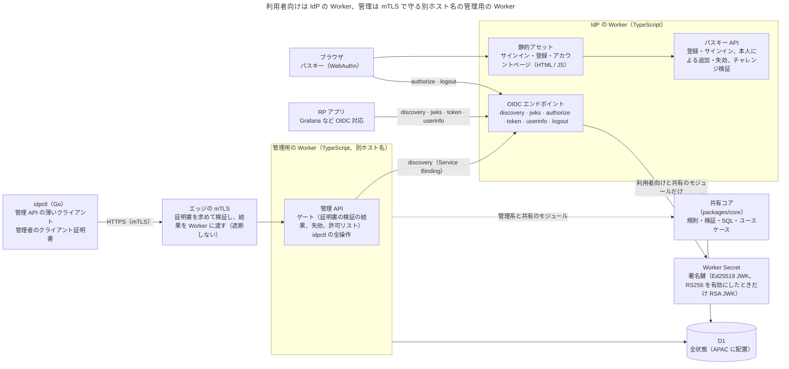

# Design Doc for IdP

Nov 7, 2026 · @Shinra Yamakawa

## 概要とゴール

Cloudflare Workers の無料枠だけで動く、パスキー専用の最小構成 OIDC IdP を自作する。対象は自分と家族のセルフホストアプリで、管理は手元の CLI から行う。

**背景**

- Pocket ID は「パスキー優先 + OIDC」という思想が理想に近いが、Go 製のため Workers の無料枠では動かせない。
- Workers + D1 で動く edge-idp は要件に近いが、管理用 MCP サーバー、メール、Webhook などで機能が膨らみ、攻撃面も広がっている。

**ゴール**

- 無料枠の範囲で常時稼働する
- ユーザーの認証手段はパスキーだけにし、OIDC と WebAuthn の標準に厳格に準拠する
- アプリ単位で「誰が使えるか」を管理できる
- 管理操作は手元の CLI から行い、管理者は IdP 自身ではなく mTLS で確かめる
- 将来、Worker を Rust で書き直せる余地を残す

**設計原則**

1. 攻撃面を小さくする（Secure by Design）。IdP の Worker がインターネットに出すのは OIDC とパスキーのエンドポイントだけで、管理 UI は作らない。管理 API は別のホスト名の管理用の Worker にだけ置き、mTLS で、管理者の証明書を持たないリクエストを、管理用の Worker のゲートでどの処理よりも前に拒否する（エッジで Worker に届く前に止める形は、IdP がゾーンのルールセットを持たない決定で外した。[ドメインの置き場所](domain-placement.md)の決定 ③）。IdP の Worker のコードには管理系のユースケースを含めない。
2. 既定値は常に安全側に倒す（Secure by Default）。例：リフレッシュトークンを発行しない、PKCE とユーザー検証（UV）を必須にする、クレームは要求されたスコープの分だけ渡す。
3. OIDC と WebAuthn は標準規格に厳格に準拠する。独自拡張や仕様の緩い解釈はせず、仕様が選択を委ねている箇所は安全側を選ぶ（[標準準拠](standards-compliance.md)参照）。
4. 迷ったら拒否する（fail-closed）。
5. 実装ではなく契約（SQL、エンコーディング、テスト）を資産にし、実装は差し替え可能にする。
6. 課金状態のように変化の速い情報は IdP に持たせない。
7. 個人情報は、IdP が機能するのに必要な分しか持たない。持つのは表示名だけで、メールアドレスは持たない（[トークン設計](tokens.md)参照）。持たない情報は漏れない。

## 全体構成

利用者と RP に公開するのは IdP の Worker 1 本だけで、状態はすべて D1 に置く。管理操作は、別のホスト名の管理用の Worker が mTLS で管理者を確かめてから行い、手元の `idpctl` はその管理 API を呼ぶだけにする。2 つの Worker は同じ D1 をバインドし、D1 を操作するロジックは TypeScript の共有コアの 1 か所に置く（[技術選定](technology.md)参照）。IdP の Worker には管理用のエンドポイントを置かない。

ブラウザは静的アセットのページ（サインイン、登録、アカウント）からパスキー API を呼び、`/authorize` と `/logout` にもアクセスする。アカウントページは、サインイン中の本人が自分のパスキーを一覧し、追加し、失効させるためのページで、サインインは常に RP からの `/authorize` を経由する。RP アプリはブラウザを `/authorize` にリダイレクトし、自身は discovery、JWKS、`/token`、`/userinfo` とだけ通信する。署名鍵を使うのは OIDC エンドポイントだけで、トークンは通常 Ed25519 で署名する（RS256 は RSA の鍵を設定したときだけ有効になる任意の機能）。管理用の Worker は署名鍵を持たず、RS256 が有効かどうかを Service Binding で IdP の Worker の discovery から読む。`idpctl` は管理者のクライアント証明書で管理用のホスト名に接続する。エッジは証明書を検証して結果を渡すだけで、証明書のないリクエストも管理用の Worker に届く。管理用の Worker は、ゲートで検証の結果と失効を確かめ、フィンガープリントの許可リストで管理者を確定してから操作する。IdP の Worker は、静的なページを含むすべてのリクエストで先に動き、平文の HTTP のリダイレクトと TLS のバージョンの確認を自分で行う（IdP はゾーンのルールセットを持たない。[ドメインの置き場所](domain-placement.md)の決定 ③）。破線は共有コアへの依存で、IdP の Worker は管理系のモジュールに依存しない。ledger や MCP などの拡張も、IdP の Worker の外に足す（[将来拡張](future-extensions.md)参照）。

## ドキュメント一覧

| ドキュメント | 内容 |
| --- | --- |
| [スコープ](scope.md) | 作るもの・作らないもの・後回しにするものと、その理由 |
| [技術選定](technology.md) | TypeScript の共有コアと 2 つの Worker、Go の薄いクライアント `idpctl` を選んだ理由、利用者向けと管理系の境界、Rust と他候補を外した理由 |
| [データモデル](data-model.md) | D1 の 16 テーブルと監査ログのテーブル、追記だけの有効・無効の出来事と今の状態のビュー、削除を拒否するトリガー、アクセス判定を一元化する `effective_access` ビュー |
| [認証フロー](authentication.md) | 認可コードフローでのサインイン、パスキーの登録、アカウントページでの本人によるパスキーの追加と失効、管理者による復旧、画面と多言語化、サインアウトの手順 |
| [認可](authorization.md) | IdP が持つ認可は「誰がどのアプリを使えるか」だけ。判定の場所と反映の遅れ、ユーザーとグループを分けるレイヤー、管理の関心事 |
| [操作とリスク](operations-and-risks.md) | IdP を通じてできる行為ごとの目的、悪用や誤りの影響、今の対策と、影響の広さによる分類 |
| [クライアントの種類](clients.md) | Web アプリ（confidential）とネイティブアプリ・CLI（public）の 2 種類と、新しいアプリのつなぎ方 |
| [トークン設計](tokens.md) | 短命トークンのみでリフレッシュトークンは発行しない。各トークンの形式と中身、署名アルゴリズム（Ed25519、任意の RS256）、署名鍵のローテーションと生成・バックアップ |
| [標準準拠](standards-compliance.md) | OIDC・OAuth・JWT・WebAuthn の準拠ポイントと、適合性テストによる確認方法 |
| [セキュリティ要件チェックリスト](security-checklist.md) | e2e の攻撃ケースとして実装する要件の一覧（実際の CVE 事例付き） |
| [管理 CLI と管理用の Worker（idpctl）](idpctl.md) | 別ホスト名の管理用の Worker と Go の `idpctl` による管理、mTLS と許可リストによる管理者の確定、REST の管理 API（エラー、Idempotency-Key、ページング）、IdP が発行する秘密の扱い、break-glass |
| [実装に依存しない契約](cross-language-contract.md) | SQL・エンコーディング・ID・鍵の形式・テストベクタと、Go と TypeScript をつなぐ管理 API の仕様の取り決め |
| [デプロイと設定](deployment.md) | アカウントの移植性、デプロイごとの入力の一覧と直書きの禁止、ホスト名を設定値で与える仕組み、変更時の影響、Cloudflare アカウント、Terraform とスクリプトの分担、デプロイのパイプライン、API トークン、鍵の生成スクリプト、ログ、署名鍵と D1 のバックアップ |
| [ドメインの置き場所](domain-placement.md) | IdP をホスト名のゾーンと同じアカウント（典型的には仕えるサービスのアカウント）に置く決定（A2）と理由、B か A1 を選ぶ条件、ゾーンをサービスと共有するときの共存の設計、残るリスク、検討した選択肢 |
| [ブートストラップ](../deployment/bootstrap.md) | 空のアカウントから最初のユーザーと RP をつなぐまでの手順の設計 |
| [無料枠の見積もりと制約](free-tier.md) | Workers と D1 の無料枠に対する見込みと、最初に確定すべき制約 |
| [将来拡張](future-extensions.md) | ledger / entitlements、管理権限の分離、MCP など、IdP の外側に足す拡張 |
| [Rust 移行計画](rust-migration.md) | IdP の Worker を Rust に置き換える条件、今のうちに守る書き方、共有コアの扱い、段階移行の順番 |
| [未決事項・要検証](open-questions.md) | 実装の前に確かめる前提と、作りながら実測で確かめること（実装前に決めることは各ドキュメントに記録済み） |
| [参考資料](references.md) | 標準規格、先行事例、CVE、Cloudflare、ライブラリへのリンク |
