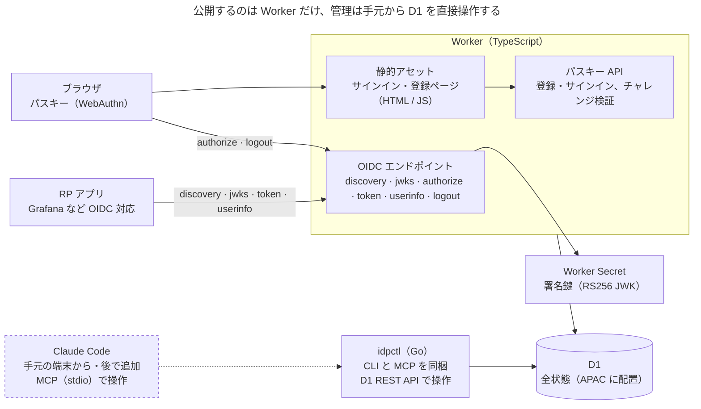

# Design Doc for IdP

Nov 7, 2026 · @Shinra Yamakawa

## 概要とゴール

Cloudflare Workers の無料枠だけで動く、パスキー専用の最小構成 OIDC IdP を自作する。対象は自分と家族のセルフホストアプリで、管理は手元の CLI から行う。

**背景**

- Pocket ID は「パスキー優先 + OIDC」という思想が理想に近いが、Go 製のため Workers の無料枠では動かせない。
- Workers + D1 で動く edge-idp は要件に近いが、管理用 MCP サーバー、メール、Webhook などで機能が膨らみ、攻撃面も広がっている。

**ゴール**

- 無料枠の範囲で常時稼働する
- ユーザーの認証手段はパスキーだけにし、OIDC と WebAuthn の標準に厳格に準拠する
- アプリ単位で「誰が使えるか」を管理できる
- 管理操作は手元の CLI から行い、後から MCP でも操作できる
- 将来、Worker を Rust で書き直せる余地を残す

**設計原則**

1. 攻撃面を小さくする（Secure by Design）。インターネットに出すのは OIDC とパスキーのエンドポイントだけで、管理 UI は作らない。
2. 既定値は常に安全側に倒す（Secure by Default）。例：リフレッシュトークンを発行しない、PKCE とユーザー検証（UV）を必須にする、クレームは要求されたスコープの分だけ渡す、`email_verified` は明示的に確認するまで `false` にする。
3. OIDC と WebAuthn は標準規格に厳格に準拠する。独自拡張や仕様の緩い解釈はせず、仕様が選択を委ねている箇所は安全側を選ぶ（[標準準拠](standards-compliance.md)参照）。
4. 迷ったら拒否する（fail-closed）。
5. 実装ではなく契約（SQL、エンコーディング、テスト）を資産にし、実装は差し替え可能にする。
6. 課金状態のように変化の速い情報は IdP に持たせない。

## 全体構成

インターネットに公開するのは Worker 1 本だけで、状態はすべて D1 に置く。管理系の書き込みは手元の `idpctl` が D1 REST API で直接行い、Worker には管理用のエンドポイントを置かない。

ブラウザは静的アセットのページからパスキー API を呼び、`/authorize` と `/logout` にもアクセスする。RP アプリはブラウザを `/authorize` にリダイレクトし、自身は discovery、JWKS、`/token`、`/userinfo` とだけ通信する。署名鍵を使うのは OIDC エンドポイントだけ。破線の Claude Code（MCP）は後から追加する要素で、ledger や管理コンソールも同じく Worker の外に別の Worker として足す。

## ドキュメント一覧

| ドキュメント | 内容 |
| --- | --- |
| [スコープ](scope.md) | 作るもの・作らないもの・後回しにするものと、その理由 |
| [技術選定](technology.md) | TypeScript + Hono の Worker と Go の idpctl を選んだ理由、Rust と他候補を外した理由 |
| [データモデル](data-model.md) | D1 の 12 テーブルと監査ログのテーブル、アクセス判定を一元化する `effective_access` ビュー |
| [認証フロー](authentication.md) | 認可コードフローでのサインイン、パスキーの登録、サインアウトの手順 |
| [認可](authorization.md) | IdP が持つ認可は「誰がどのアプリを使えるか」だけ。判定の場所と反映の遅れ、ユーザーとグループを分けるレイヤー、管理の関心事 |
| [操作とリスク](operations-and-risks.md) | IdP を通じてできる行為ごとの目的、悪用や誤りの影響、今の対策と、影響の広さによる分類 |
| [クライアントの種類](clients.md) | Web アプリ（confidential）とネイティブアプリ・CLI（public）の 2 種類と、新しいアプリのつなぎ方 |
| [トークン設計](tokens.md) | 短命トークンのみでリフレッシュトークンは発行しない。各トークンの形式と中身、署名鍵のローテーションと生成・バックアップ |
| [標準準拠](standards-compliance.md) | OIDC・OAuth・JWT・WebAuthn の準拠ポイントと、適合性テストによる確認方法 |
| [セキュリティ要件チェックリスト](security-checklist.md) | e2e の攻撃ケースとして実装する要件の一覧（実際の CVE 事例付き） |
| [管理 CLI / MCP（idpctl）](idpctl.md) | 手元の Go 製 CLI から D1 を直接操作する管理の仕組みと、秘密の扱い |
| [TypeScript と Go の契約](cross-language-contract.md) | Worker と idpctl をつなぐ SQL・エンコーディング・テストベクタの取り決め |
| [デプロイと設定](deployment.md) | ホスト名を設定値で与える仕組み、変更時の影響、IdP 専用アカウントと API トークンの扱い、署名鍵と D1 のバックアップ |
| [無料枠の見積もりと制約](free-tier.md) | Workers と D1 の無料枠に対する見込みと、最初に確定すべき制約 |
| [将来拡張](future-extensions.md) | ledger / entitlements、管理コンソールなど、IdP の外側に足す拡張 |
| [Rust 移行計画](rust-migration.md) | Worker を Rust に置き換える条件、今のうちに守る書き方、段階移行の順番 |
| [未決事項・要検証](open-questions.md) | 作りながら実測で確かめること（実装前に決めることは各ドキュメントに記録済み） |
| [参考資料](references.md) | 標準規格、先行事例、CVE、Cloudflare、ライブラリへのリンク |
