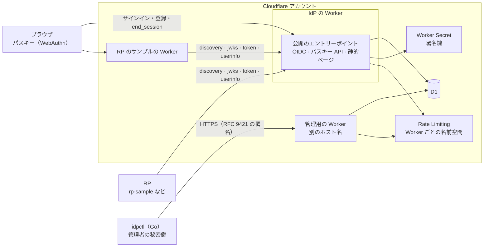
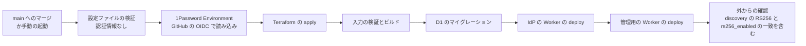

# インフラの構成

Cloudflare の上で、どの要素がどうつながり、どうデプロイされるかを図で示す。
要素の役割と設計の理由は、[設計ドキュメントの索引](README.md)の全体構成と、各トピックの設計に置く。ここでは繰り返さず、つながりだけを示す。

## 要素

| 要素 | 役割 | 詳細 |
| --- | --- | --- |
| IdP の Worker（TypeScript + Hono） | 利用者と RP に公開する要素。OIDC エンドポイント、パスキー API、サインイン・登録・アカウントページを提供する | [認証フロー](authentication.md)、[トークン設計](tokens.md) |
| 管理用の Worker（TypeScript） | 別のホスト名に置く管理 API。要求ごとの RFC 9421 の署名を署名鍵の許可リストで検証して、Worker 自身が管理者を確かめる | [管理 CLI と管理用の Worker](idpctl.md)、[ホスティングのモード](hosting-modes.md)の 3 |
| 共有コア（TypeScript） | ドメインの規則、入力の検証、SQL、ユースケースを 1 か所に持ち、2 つの Worker が使う | [技術選定](technology.md) |
| D1 | IdP の全状態を置くデータベース。2 つの Worker が同じものをバインドする | [データモデル](data-model.md) |
| `idpctl`（Go） | 手元で動かす管理 CLI。管理 API を呼ぶだけの薄いクライアントで、ドメインの規則は評価しない | [管理 CLI と管理用の Worker](idpctl.md) |
| RP のサンプル | 別の Worker として動く、標準どおりの RP の参照実装。IdP からは import しない | [クライアントの種類](clients.md) |

IdP の Worker には管理用のエンドポイントや管理 UI を置かない。

## 実行時のつながり

- 2 つの Worker の間にバインディングはない。RS256 が有効かどうかは、デプロイの設定ファイルの `rs256_enabled` を 2 つの Worker が同じ変数 `RS256_ENABLED` で受け取って決め、デプロイの後の確認が、discovery がそのとおりに `RS256` を載せているかを確かめる（[デプロイと設定](deployment.md)のデプロイのパイプライン）。
- 2 つの Worker は同じ D1 をバインドする。レート制限の名前空間は Worker ごとに別にする（[技術選定](technology.md)）。
- 公開するホスト名は、モードによってカスタムドメインか `workers.dev` になる（[ホスティングのモード](hosting-modes.md)）。

## デプロイのパイプライン

各段の中身、順番の保証、認証情報の渡し方、残るリスクは [デプロイと設定](deployment.md)のデプロイのパイプラインに置く。最初のデプロイは [ブートストラップ](../deployment/bootstrap.md)と[実行手順](../deployment/runbook.md)に沿って運用者が行う。
