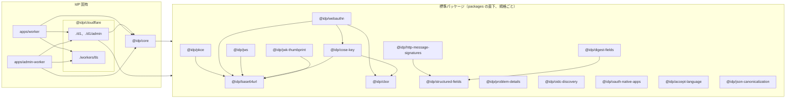

# 標準の実装のパッケージへの分割

Nov 13, 2026 · @Shinra Yamakawa

`packages/core` に混ざっている標準規格の実装（base64url、JWS、CBOR、COSE、WebAuthn の検証、RFC 9421 の検証など）を、規格ごとの独立したパッケージに切り出す計画を記録する。方針は運用者が承認済みで（下の「決定」）、この文書はファイルごとの行き先、パッケージの依存、結合の問題の解き方、PR の順番を決める。この文書の PR はコードを動かさない。

## 決定

運用者が承認した方針は次のとおり。

1. **標準ごとに 1 つのパッケージ**：標準規格の実装は、実装する規格の名前を付けた平らなパッケージとして `packages/` の直下に置く（例：`packages/base64url/`）。パッケージは、同じ `packages/` の配置を持つ別のリポジトリにそのままコピーすれば使える（下の「コピーで使えることの条件」）。
2. **依存は標準パッケージと Web 標準の API だけ**：標準パッケージが依存してよいのは、ほかの標準パッケージ（循環なし）と、Web 標準の API（Web Crypto、`TextEncoder` と `TextDecoder`、`URL`、`Headers`、`atob` と `btoa`）だけ。workerd、Node、Cloudflare、D1、Zod、IdP の型には依存しない。各パッケージは自分の `package.json` とテストを持ち、規格がテストベクタを持つときはそれをテストに含める。
3. **`shared` を廃止する**：`shared` というディレクトリ名は使わない。`user/` と `admin/` の両方が使う IdP 固有の方針は、関心ごとのディレクトリとして `packages/core/src/` の直下、`user/` と `admin/` の隣に平らに置く（例：`packages/core/src/audit/`、`packages/core/src/identifiers/`）。`packages/core/package.json` の `exports` もそれに合わせる。
4. **きれいに分けられないことは設計の問題として扱う**：標準のロジックが IdP の方針ときれいに分けられないことは、core に残す理由にせず、設計の問題として下の「結合の問題と解き方」に記録し、そこで解く。
5. **パッケージのスコープは `@idp`**：新しいパッケージはすべて `@idp` のスコープを持つ（例：`@idp/base64url`、`@idp/jws`）。運用者が決定済み。
6. **Cloudflare に固有のコードは `@idp/cloudflare` の 1 つにまとめる**：`@idp/workers-platform` は置かない。`packages/cloudflare/` に `@idp/cloudflare` を置き、関心ごとのサブパスの `exports` を持たせる。`./d1` は今の `@idp/d1-adapter` を `src/d1/` に移したもの、`./workers/tls` は `shared/tls.ts` を `src/workers/tls/` に移したもの。Cloudflare に固有の関心が増えたら、`workers/rate-limit` や `r2` のようにサブパスを足す。依存の規則は下の「`@idp/cloudflare` の規則」のとおりで、lint と境界のテストで強制する。
7. **`@idp/structured-fields` は RFC 9651 どおりにする**：重複したキーの後勝ちを含めて RFC 9651 に正確に従い、HTTP WG の structured-field-tests を通す。今の IdP が重複したキーを拒否する動作は core の方針として残し、IdP の外から見える振る舞いは変えない（下の結合の問題 7）。
8. **`canonicalJson` を RFC 8785 の標準パッケージにする**：`admin/idempotency.ts` の `canonicalJson` を、規格の名前を付けた `@idp/json-canonicalization`（RFC 8785、JSON Canonicalization Scheme）に切り出し、RFC 8785 に完全に従わせて、RFC のテストベクタを通す。今の実装が RFC 8785 とずれていれば、パッケージの中で直し、IdP に固有の制限は core に残して、冪等性の振る舞いを変えない（下の結合の問題 13）。
9. **`examples/rp-sample` は標準パッケージを使わない**：RP のサンプルは IdP のリポジトリのコードを import しない今の lint の禁止を保ち、標準パッケージもその対象に含める。

## 標準パッケージの規則

**配置**

- `packages/<規格の名前>/package.json`：`name` は `@idp/<規格の名前>`、`private: true`、`type: module`、`exports` は `"."` だけで `./src/index.ts` を指す（既存の `packages/core` と同じく、ビルドせずに TypeScript のソースを公開する）。`dependencies` には依存する標準パッケージだけを `workspace:*` で書く。
- `packages/<規格の名前>/src/index.ts`：公開する名前の再エクスポートだけを置く。
- `packages/<規格の名前>/src/<規格の名前>.ts`：実装。大きいパッケージは関心ごとに複数のファイルに分けてよい。
- `packages/<規格の名前>/test/`：そのパッケージのテストと、規格のテストベクタ。
- `packages/<規格の名前>/tsconfig.json`：`src/` だけを対象に、`types` を空にし、`lib` を ES2024 と WebWorker にする。ルートの `tsconfig.json` は `@cloudflare/workers-types` と `node` の型を全体に入れるので、ルートの型検査だけでは Node や Workers の大域の型を使っても通ってしまう。パッケージごとの `tsconfig.json` を `pnpm run typecheck` から実行して、Web 標準の外の API を型の段階で止める。

**依存の禁止の強制**

- `eslint.config.js` に、`packages/<標準パッケージ>/src/**` を対象にした `no-restricted-imports` を足す。許すのは、同じパッケージの中の相対の import と、依存として宣言した `@idp/<標準パッケージ>` だけ。`node:*`、`cloudflare:*`、`@cloudflare/*`、`zod`、`hono`、`@idp/core` とその下、`@idp/cloudflare` とその下、パッケージの外に出る相対の import（`../../` で始まるもの）を禁止する。
- `packages/core/test/boundary.test.ts` に、標準パッケージから上の禁止に当たる import をすると lint が失敗する場合と、別の標準パッケージの import が通る場合を足す。
- 標準パッケージの間の依存は下の「依存グラフ」のとおりで、循環を作らない。グラフにない辺を足すときはこの文書を先に直す。

**コピーで使えることの条件**

別のリポジトリに `packages/<規格の名前>/` を丸ごとコピーすれば使える条件は、次のとおり。

- コピー先が pnpm の workspace で、`packages/*` を workspace に含めている。
- 依存する標準パッケージも同じ名前（`@idp/<規格の名前>`）で、同じ `packages/` の下にコピーする。
- コピー先が TypeScript のソースを直接読むバンドラかテストランナー（Vite、Vitest など）を使う。
- テストを実行するなら、コピー先に Vitest がある。テストは Vitest と Node の組み込みのモジュール（鍵の生成に使う `node:crypto` など）を使ってよいが、`src/` は使わない。テストはこのリポジトリの `contract/testdata` を読まない（下の「テストとテストベクタ」）。

## パッケージの一覧

| パッケージ | 規格 | 中身 | 元のファイル | 依存 | テストベクタ |
| --- | --- | --- | --- | --- | --- |
| `@idp/base64url` | RFC 4648 §5（RFC 7515 §2 のパディングなし） | パディングなしの base64url の符号化と、正規形だけを受け付ける厳格な復号 | `shared/base64url.ts` | なし | RFC 4648 §10 |
| `@idp/jwk-thumbprint` | RFC 7638、RFC 8037 §2 | JWK の thumbprint（SHA-256）と、SHA-256 の base64url の補助関数 | `shared/jwk.ts`、`shared/hash.ts` | base64url | RFC 7638 §3.1、RFC 8037 付録 A.3 |
| `@idp/cbor` | RFC 8949 | WebAuthn が使う部分集合（長さが確定し、浮動小数点とタグを持たない）の復号 | `user/webauthn/cbor.ts` | なし | RFC 8949 付録 A（部分集合の外の値は拒否されることを確かめる） |
| `@idp/cose-key` | RFC 9052 §7、RFC 9053、RFC 8230 | COSE の公開鍵の取り込みと署名の検証（-8、-7、-257） | `user/webauthn/cose.ts` | cbor、base64url | RFC 9052 付録 C.7 |
| `@idp/jws` | RFC 7515、RFC 7518、RFC 8037、RFC 9864、RFC 7517 | JWS のコンパクト形式の署名と検証、アルゴリズム（`Ed25519`、`RS256`）、公開鍵の JWK と JWK Set の型 | `user/jws.ts`、`user/signing-keys.ts` の型 | base64url | RFC 8037 付録 A.4、RFC 7515 付録 A.2 |
| `@idp/webauthn` | WebAuthn Level 3 §7.1、§7.2 | 登録と認証の応答の解析と検証 | `user/webauthn/verify.ts` | base64url、cbor、cose-key | WebAuthn Level 3 の仕様にあるテストベクタ（下の前提 6） |
| `@idp/structured-fields` | RFC 9651 | List、Dictionary、Item（Date と Display String を含むすべての Bare Item）の解析と直列化。RFC 9651 が回復を指示する箇所（重複したキーの後勝ちなど）を呼び出し側に知らせる口を持つ | `admin/structured-fields.ts` | なし | HTTP WG の structured-field-tests と RFC 9651 の本文の例（下の結合の問題 7） |
| `@idp/digest-fields` | RFC 9530 | `Content-Digest` の解析（`sha-256`）と本文のダイジェストの定数時間の比較 | `admin/signature.ts` の一部 | structured-fields | RFC 9530 付録 B |
| `@idp/http-message-signatures` | RFC 9421（検証） | `Signature-Input` と `Signature` の取り出し、署名の基底（§2.5）の組み立て、`ecdsa-p384-sha384` の検証 | `admin/signature.ts` の一部 | structured-fields | RFC 9421 付録 B.2 の署名の基底 |
| `@idp/problem-details` | RFC 9457 | problem details のオブジェクトの型と `application/problem+json` | `admin/problem.ts` の型 | なし | なし（規格にない） |
| `@idp/pkce` | RFC 7636 | `code_verifier` の形（§4.1）、S256 の `code_challenge` の計算（§4.2）と形 | `user/token.ts`、`user/authorize.ts` の一部 | base64url | RFC 7636 付録 B |
| `@idp/oidc-discovery` | OpenID Connect Discovery 1.0、RP-Initiated Logout 1.0 §2.1 | OpenID Provider Metadata（§3）の型と、well-known の場所（§4） | `user/discovery.ts` の型 | なし | なし（規格にない） |
| `@idp/oauth-native-apps` | RFC 8252 §7、§7.3、§8.3、RFC 9700 §2.1 | redirect URI の 3 つの登録の形の分類、ループバックの IP リテラル、ループバックのポートを無視する一致と、それ以外の完全一致 | `shared/redirect-uri-registration.ts` の一部、`user/redirect-uri.ts` | なし | なし（規格にない） |
| `@idp/accept-language` | RFC 9110 §12.5.4、§12.4.2 | `Accept-Language` の解析（q 値の順） | `user/locale.ts` の一部 | なし | RFC 9110 §12.5.4 の例 |
| `@idp/json-canonicalization` | RFC 8785 | JSON の値の正規の直列化（JCS） | `admin/idempotency.ts` の `canonicalJson` | なし | RFC 8785 の本文と付録の例（下の結合の問題 13） |

標準パッケージではないが、この分割で新しく置くパッケージが 1 つある。

| パッケージ | サブパス | 中身 | 元のファイル | 依存 |
| --- | --- | --- | --- | --- |
| `@idp/cloudflare` | `./d1`、`./d1/admin` | core の D1 のポートの、Cloudflare D1 による実装 | `packages/d1-adapter/src/` | `@idp/core`（ポートの型）、標準パッケージ |
| `@idp/cloudflare` | `./workers/tls` | `request.cf.tlsVersion` による TLS の版の確認 | `shared/tls.ts` | なし（型は `@cloudflare/workers-types`） |

## `@idp/cloudflare` の規則

Cloudflare の上でだけ意味を持つコード（D1、Workers の `request.cf`、将来の Rate Limiting や R2）は、`packages/cloudflare/` の 1 つのパッケージに、関心ごとのサブパスとして置く。

**配置**

- `packages/cloudflare/package.json`：`name` は `@idp/cloudflare`。`exports` は関心ごとのサブパスだけを持ち、`"."` を持たない。今のサブパスは `./d1`（`./src/d1/index.ts`）、`./d1/admin`（`./src/d1/admin.ts`、管理用の Worker だけが使う D1 の実装）、`./workers/tls`（`./src/workers/tls/index.ts`）。
- `packages/cloudflare/src/<サブパス>/`：サブパスごとのソース。`packages/cloudflare/test/<サブパス>/`：サブパスごとのテスト（今の D1 の適合テストは `test/d1/` に移る）。
- 新しい関心は、`src/workers/rate-limit/` や `src/r2/` のようにサブパスを足し、この文書の下の辺の一覧を先に直す。

**依存の規則**

- core と標準パッケージは、`@idp/cloudflare` とその下を import しない。
- `./d1` と `./d1/admin` は core のポートを実装する。import してよいのは `@idp/core` の入口と標準パッケージだけ。
- `./workers/tls` は、core も `./d1` も import しない。
- サブパスの間の import は、宣言した辺だけを許す。今は宣言した辺はない（`./d1/admin` から `./d1` へのパッケージの中の import を除く）。
- `apps/*` が合成の層で、core と `@idp/cloudflare` のサブパスをつなぐ。
- 強制：`eslint.config.js` の `no-restricted-imports` で上の禁止を書き、`packages/core/test/boundary.test.ts` に、禁止に当たる import で lint が失敗する場合と、許す import が通る場合を足す。利用者向けの IdP の Worker から `./d1/admin` への import は、今の `@idp/d1-adapter/admin` と同じく禁止する。

## 依存グラフ

矢印は「依存する」。破線の左側は標準パッケージ、右側は IdP 固有のパッケージ。標準パッケージから右側への矢印はない。

`@idp/core` は標準パッケージのすべてに依存してよい。core と標準パッケージから `@idp/cloudflare` への矢印はなく、`./workers/tls` から core と `./d1` への矢印もない（上の「`@idp/cloudflare` の規則」）。`examples/rp-sample` はこのグラフの外にあり、どのパッケージにも依存しない。`apps/` が標準パッケージを直接 import するのは、テストで値を作るとき（base64url など）だけにし、本番のコードは core を通す。

## core の新しい構成

`packages/core/src/shared/` をなくし、中身を関心ごとのディレクトリに分ける。各ディレクトリは `index.ts` を持ち、外からはその `index.ts` だけを import する。

| ディレクトリ | 中身 | 依存してよい core の関心 |
| --- | --- | --- |
| `src/db/` | D1 のポート（`Database`、`SqlStatement` など）と、`SqlCondition`（今は `audit.ts` にある） | なし |
| `src/identifiers/` | UUIDv4、client ID、トークンの形、credential ID の形、乱数のトークンの生成 | なし |
| `src/issuer/` | issuer の設定の解析と、RP ID と origin の導出 | なし |
| `src/hosting/` | ホスティングのモードとホスト名の規則 | なし |
| `src/problems/` | 管理 API の problem の種類の一覧（`PROBLEM_KINDS`） | なし |
| `src/clients/` | redirect URI と post-logout redirect URI の登録の方針（長さの上限、client の種類ごとの制限、`state` の禁止、規則の説明文） | なし |
| `src/passkeys/` | パスキーの上限と、パスキーの規則の SQL の条件 | db |
| `src/audit/` | 監査ログの行の組み立て | db、identifiers、problems、clients |
| `src/user/` | 利用者向けのユースケース（今のまま） | 上のすべて |
| `src/admin/` | 管理系のユースケース（今のまま） | 上のすべて |

- 関心のディレクトリは `user/` と `admin/` を import しない。今の `shared/` と同じく `admin/` の禁止を lint で強制し、`user/` の禁止も足す（今の `shared/index.ts` の注記にはあるが、lint は `admin/` しか止めていない）。
- 関心のディレクトリの間の依存は上の表の列のとおりで、循環を作らない。
- `eslint.config.js` の利用者向けのコードの対象（今は `packages/core/src/shared/**/*.ts`）は、`packages/core/src/` の下の `admin/` 以外のディレクトリに置き換える。
- `packages/core/test/admin/framework.test.ts` の「Zod を import しない」の確認の対象（今は `shared` と `user`）は、`admin/` 以外のすべての関心のディレクトリにする。

**`packages/core/package.json` の `exports`**

`./shared`、`./shared/hosting`、`./shared/issuer` をなくし、次にする。`./hosting` と `./issuer` は、今の `./shared/hosting` と `./shared/issuer` と同じく、ほかのモジュールを import しない入口で、`cloudflare.config.ts` が使う。

| 入口 | 指す先 |
| --- | --- |
| `./audit` | `./src/audit/index.ts` |
| `./clients` | `./src/clients/index.ts` |
| `./db` | `./src/db/index.ts` |
| `./hosting` | `./src/hosting/index.ts` |
| `./identifiers` | `./src/identifiers/index.ts` |
| `./issuer` | `./src/issuer/index.ts` |
| `./passkeys` | `./src/passkeys/index.ts` |
| `./problems` | `./src/problems/index.ts` |
| `./user` | `./src/user/index.ts`（今のまま） |
| `./admin` | `./src/admin/index.ts`（今のまま） |

`dependencies` には、使う標準パッケージを `workspace:*` で足す。Zod は core の依存のまま残す（下の結合の問題 4）。

## 現在のファイルの行き先

`packages/core/src` のすべてのファイルの行き先。「残る」は同じ場所に残り、import だけを書き換えるもの。

| 現在のファイル | 行き先 | 備考 |
| --- | --- | --- |
| `shared/audit.ts` | `core/src/audit/audit.ts` | `SqlCondition` は `core/src/db/` へ |
| `shared/base64url.ts` | `packages/base64url/src/base64url.ts` | |
| `shared/db.ts` | `core/src/db/database.ts` | `SqlCondition` を受け入れる |
| `shared/hash.ts` | `packages/jwk-thumbprint/src/sha256.ts` | `sha256Base64url`。core のトークンとシークレットのハッシュもこれを使う |
| `shared/hosting.ts` | `core/src/hosting/hosting.ts` | |
| `shared/identifiers.ts` | `core/src/identifiers/identifiers.ts` | base64url を `@idp/base64url` から使う |
| `shared/index.ts` | 削除 | 関心ごとの `index.ts` に置き換える |
| `shared/issuer.ts` | `core/src/issuer/issuer.ts` | |
| `shared/jwk.ts` | `packages/jwk-thumbprint/src/jwk-thumbprint.ts` | |
| `shared/limits.ts` | `core/src/passkeys/limits.ts` | |
| `shared/passkey-rules.ts` | `core/src/passkeys/passkey-rules.ts` | `SqlCondition` を `db` から使う |
| `shared/problems.ts` | `core/src/problems/problem-kinds.ts` | |
| `shared/redirect-uri-registration.ts` | 分割：`packages/oauth-native-apps/src/redirect-uri.ts` と `core/src/clients/redirect-uri-registration.ts` | 結合の問題 9 |
| `shared/tls.ts` | `packages/cloudflare/src/workers/tls/tls.ts` | 結合の問題 3 |
| `user/authorize.ts` | 残る | `code_challenge` の形の確認に `@idp/pkce` を使う |
| `user/clients.ts` | 残る | |
| `user/deps.ts` | 残る | |
| `user/discovery.ts` | 残る | 文書の型を `@idp/oidc-discovery` の型に、JWKS の型を `@idp/jws` の JWK Set に合わせる |
| `user/end-session.ts` | 残る | |
| `user/index.ts` | 残る | 移したものの再エクスポートを外す（結合の問題 5） |
| `user/jws.ts` | `packages/jws/src/jws.ts` | `InvalidTokenError` は core に残す（結合の問題 5） |
| `user/locale.ts` | 残る | `Accept-Language` の解析を `@idp/accept-language` へ |
| `user/redirect-uri.ts` | `packages/oauth-native-apps/src/redirect-uri-match.ts` | 全体が RFC 8252 §7.3 と RFC 9700 §2.1 の一致の規則 |
| `user/sessions.ts` | 残る | |
| `user/signing-keys.ts` | 残る | `JwsAlgorithm`、鍵の型、公開鍵の JWK の型を `@idp/jws` へ（結合の問題 5） |
| `user/token.ts` | 残る | `code_verifier` の形と S256 の計算を `@idp/pkce` へ |
| `user/tokens.ts` | 残る | `InvalidTokenError` の新しい置き場所 |
| `user/userinfo.ts` | 残る | |
| `user/webauthn/cbor.ts` | `packages/cbor/src/cbor.ts` | |
| `user/webauthn/ceremony.ts` | 残る | `PUB_KEY_CRED_PARAMS` をここで方針として定める（結合の問題 6） |
| `user/webauthn/cose.ts` | `packages/cose-key/src/cose-key.ts` | |
| `user/webauthn/credentials.ts` | 残る | |
| `user/webauthn/enroll.ts` | 残る | |
| `user/webauthn/registration.ts` | 残る | |
| `user/webauthn/self-service.ts` | 残る | |
| `user/webauthn/sign-in.ts` | 残る | |
| `user/webauthn/verify.ts` | `packages/webauthn/src/verify.ts` | `PUB_KEY_CRED_PARAMS` は core へ、`RelyingParty` は自前の型へ（結合の問題 6） |
| `admin/access.ts` | 残る | |
| `admin/audit-tail.ts` | 残る | |
| `admin/clients.ts` | 残る | |
| `admin/enablement.ts` | 残る | |
| `admin/execute.ts` | 残る | |
| `admin/grants.ts` | 残る | |
| `admin/groups.ts` | 残る | |
| `admin/idempotency.ts` | 残る | `canonicalJson` を `@idp/json-canonicalization` へ。IdP に固有の制限があれば残す（結合の問題 13） |
| `admin/index.ts` | 残る | |
| `admin/nonces.ts` | 残る | |
| `admin/operation.ts` | 残る | |
| `admin/outputs.ts` | 残る | |
| `admin/paging.ts` | 残る | カーソルの形は IdP の方針 |
| `admin/passkeys.ts` | 残る | |
| `admin/problem.ts` | 残る | problem details の型を `@idp/problem-details` の型に合わせる |
| `admin/registry.ts` | 残る | |
| `admin/schemas.ts` | 残る | |
| `admin/signature.ts` | 分割：`packages/http-message-signatures/`、`packages/digest-fields/`、残りは `admin/signature.ts` | 結合の問題 8 |
| `admin/structured-fields.ts` | `packages/structured-fields/src/structured-fields.ts` | RFC 9651 どおりに直す。重複の拒否などの厳しさは `admin/signature.ts` の方針へ（結合の問題 7） |

`packages/d1-adapter` のファイルの行き先。

| 現在のファイル | 行き先 |
| --- | --- |
| `d1-adapter/src/index.ts`、`src/d1.ts` | `packages/cloudflare/src/d1/index.ts`、`src/d1/d1.ts` |
| `d1-adapter/src/admin.ts` | `packages/cloudflare/src/d1/admin.ts` |
| `d1-adapter/test/conformance.test.ts`、`test/admin-nonces.test.ts` | `packages/cloudflare/test/d1/` |
| `d1-adapter/package.json` | 削除。`packages/cloudflare/package.json` に置き換える |
| `admin/users.ts` | 残る | |

## 結合の問題と解き方

**1. `shared/passkey-rules.ts` が `SqlCondition` を `audit.ts` から import している**

`SqlCondition` は監査ログの型ではなく、ガード付きの文の `WHERE` に入る SQL の条件で、D1 のポートの語彙である。`SqlStatement` と同じ `core/src/db/` に移し、`audit/`、`passkeys/`、`admin/` のすべてが `db` から import する。パスキーの規則は監査ログに依存しなくなる。

**2. `shared/audit.ts` が `redirect-uri-registration` と `identifiers` を import している**

監査ログの行の組み立てが ID と redirect URI の形を確かめるのは、`detail_json` に名前を入れない性質（設計原則 7）そのもので、依存は正当である。問題は、`shared/` の中で依存の向きが決まっていなかったことにある。分割の後は、`audit/` が `identifiers/`、`problems/`、`clients/`、`db/` に依存し、そのどれも `audit/` に依存しない向きを、上の「core の新しい構成」の表で固定する。redirect URI の形のうち規格の部分（登録の 3 つの形）は `@idp/oauth-native-apps` に移り、`clients/` を通して使う。

**3. `shared/tls.ts` が Cloudflare の `request.cf` を読む**

`request.cf.tlsVersion` は Cloudflare の Workers の上にしかない値で、標準パッケージにも core にも置けない。2 つの Worker の両方が使うので、どちらかの Worker に置くと、もう片方がそれを import するか複製することになる。`@idp/cloudflare` のサブパス `./workers/tls`（`packages/cloudflare/src/workers/tls/`）に移し、`apps/worker/src/app.ts` と `apps/admin-worker/src/gate.ts` がそこから import する。D1 のアダプタも同じパッケージの `./d1` に移るが、`./workers/tls` は `./d1` も core も import しないので、TLS の確認が D1 や IdP の型を持ち込むことはない。core は TLS の版を知らなくなる。受け付ける版の一覧（TLS 1.2 と 1.3、RFC 8996）と fail-closed の性質は変えない。

**4. core が Zod に依存している**

Zod を使うのは `admin/` の入力と出力のスキーマだけで、標準パッケージの決定（2）が禁じるのは標準パッケージの依存である。core は標準パッケージではないので、Zod は core の依存として残す。そのうえで、次の 2 つを lint とテストで強制する。

- 標準パッケージは Zod を import しない（上の「依存の禁止の強制」）。
- core の中で Zod を import するのは `admin/` だけ（今の `framework.test.ts` の確認の対象を、`shared` と `user` から `admin/` 以外のすべての関心のディレクトリに広げる）。IdP の Worker のバンドルに Zod が入らない性質は今のまま保つ。

**5. `user/jws.ts` が IdP の型（`signing-keys.ts` の `JwsAlgorithm` と `SigningKey`）に依存している**

今は JWS の実装が IdP の鍵の型を import し、鍵の型の定義が JWS のアルゴリズムを決めている。向きを逆にする。

- `@idp/jws` が、アルゴリズムの型（`Ed25519` と `RS256`）、署名に使う鍵と検証に使う鍵の型（`kid`、`alg`、`CryptoKey`）、公開鍵の JWK の型（RFC 8037 §2 の OKP と RFC 7518 §6.3.1 の RSA）、JWK Set の型（RFC 7517 §5）を定義する。
- `user/signing-keys.ts` は、Worker Secret の JWK を読む契約（`use: sig`、枠ごとの `alg`、`kid` と thumbprint の一致）だけを持ち、型は `@idp/jws` から使う。
- `typ` の値（`JWT` と `at+jwt`、RFC 9068 §2.1）は IdP の方針なので、パッケージは `typ` を文字列の引数として受け取り、`JWT` と `at+jwt` に絞る型は `user/tokens.ts` に残す。
- 今の検証は、ヘッダーが `alg`、`kid`、`typ` のちょうど 3 つであることと、長さの上限（8192 文字）を求める。これは RFC 7515 より厳しい IdP の決まりだが、振る舞いを変えないため、移す PR ではパッケージの既定の振る舞いとしてそのまま持っていく。
- パッケージの例外は `InvalidJwsError` にする。`InvalidTokenError` はクレームの確認の失敗にも使う IdP の型なので `user/tokens.ts` に残し、`user/tokens.ts` が `InvalidJwsError` を捕まえて `cause` 付きの `InvalidTokenError` に包む。HTTP の層が受け取る例外は今と同じになる。

**6. `user/webauthn/verify.ts` と `cose.ts` が IdP の型と方針を持っている**

- `verify.ts` の `RelyingParty` は IdP の `Issuer` から作った型である。`@idp/webauthn` は RP ID と origin だけを持つ自前の型を定義し、core の `Issuer` はその形を構造的に満たすので、呼び出し側は今のまま `Issuer` を渡せる。
- `COSE_ALGORITHMS` は「実装が検証できるアルゴリズム」と「IdP が `pubKeyCredParams` で提示する順番」を兼ねている。`@idp/cose-key` は前者（-8、-7、-257）だけを持ち、IdP が提示する順番と `PUB_KEY_CRED_PARAMS` は `user/webauthn/ceremony.ts` に方針として置く。値も順番も今と同じにする。
- `verify.ts` の検証は、attestation `none`（packed の self attestation を含む）、ユーザー検証の必須、拡張なしという IdP の要求に合わせて、手順を固定している。移す PR では振る舞いを変えず、パッケージの説明にこの範囲を書く。

**7. `admin/structured-fields.ts` は RFC 9651 より厳しい**

この解析器は、重複したキー（Dictionary の成員と Parameters の両方）を RFC 9651 のように後勝ちで受け入れず、エラーにする。Date と Display String を扱わず、空の Dictionary を拒否し、Byte Sequence のパディングの欠けと 0 でないパディングのビットを拒否する（RFC 9651 §4.2.7 は、どちらも失敗させないことを SHOULD とする）。どれも管理者の署名の形（`docs/design/hosting-modes.md` の 3.2）のための選択で、汎用の RFC 9651 の実装ではない。決定 7 のとおり、パッケージと方針を次のように分ける。

- `@idp/structured-fields` は RFC 9651 に正確に従う。List、Dictionary、Item の解析（§4.2）と直列化（§4.1）、Date と Display String を含むすべての Bare Item、重複したキーの後勝ちを実装し、HTTP WG の structured-field-tests をパッケージの `test/` に写して通す。
- RFC 9651 が失敗させずに回復するように指示する箇所（重複した Dictionary のキー、重複した Parameters のキー、パディングの欠けた Byte Sequence、0 でないパディングのビット）では、パッケージは既定では RFC どおりに回復し、呼び出し側が渡した観察の関数があれば、回復の種類と場所を知らせる。観察の関数は失敗を決めない仕組みで、何を拒否するかは呼び出し側が決める。
- 管理者の署名の厳しさは core の方針として `admin/signature.ts` の側に残す。観察の関数で回復の知らせを受けたら拒否し、解析の結果に Date か Display String があれば拒否し、空の Dictionary を拒否する。拒否はどれも今と同じ `malformed` になり、受け付けるヘッダーの集合と拒否の理由は今と同じになる。
- 直列化（`@signature-params` の行、RFC 9421 §2.3）は、今の解析器が受け付ける値に対しては今と同じ文字列を出す。小数の丸め（§4.1.5 の偶数への丸め）が今の実装と違いうるのは、小数部が 4 桁以上の値だけで、解析器はそれを受け付けないので、署名の基底は変わらない。

**8. `admin/signature.ts` は RFC 9421 の検証と管理者の署名の形を混ぜている**

1 つのファイルに、RFC 9421 の一般的な部分と、管理者の署名の形（`docs/design/hosting-modes.md` の 3.2 から 3.8）が混ざっている。次のように分ける。

- `@idp/http-message-signatures`：`Signature-Input` と `Signature` の Dictionary から 1 つのラベルの成員を取り出すこと、署名の基底（§2.5）の組み立て（`@method`、`@target-uri`、`@authority` とヘッダー）、鍵のアルゴリズムが ECDSA P-384 であることの確認と `ecdsa-p384-sha384` の検証（§3.3.5）。アルゴリズムは要求ではなく鍵から決める（§3.2.1、§7.3.4）。
- `@idp/digest-fields`：`Content-Digest` の解析と本文の SHA-256 の定数時間の比較（RFC 9530）。
- `admin/signature.ts` に残すもの：覆う成分の固定の一覧、`tag` の値、`created` の時間の窓、`keyid` の形（SPKI の SHA-256 の 16 進）、`nonce` の形、許可リストの照合、拒否の理由（`AdminSignatureRefusal`）と確認の順番。

確認の順番（item 4 から 9）と拒否の理由は IdP の契約なので、`admin/signature.ts` が 2 つのパッケージの関数を今と同じ順番で呼び、同じ理由を返す。

**9. redirect URI の規則は規格と方針が 1 つの関数に混ざっている**

`classifyRedirectUri` は、RFC 8252 の 3 つの登録の形の分類と、IdP の方針（2000 文字の上限、印字できる ASCII だけ）を 1 つの関数でまとめて判定している。

- `@idp/oauth-native-apps`：URL の構文解析器が出す正規形であること（完全一致の比較のため、RFC 9700 §2.1）、3 つの形の分類（RFC 8252 §7.1 の逆ドメインのカスタムスキーム、§7.3 のループバックの IP リテラル、https）、`localhost` の拒否（§8.3）、ループバックの IP リテラルの一覧、ループバックのポートを無視する一致（§7.3）とそれ以外の完全一致（今の `user/redirect-uri.ts` の全体）。
- `core/src/clients/`：長さの上限と印字できる ASCII の確認を先に行ってからパッケージの分類を呼ぶこと、client の種類ごとの制限（confidential は https だけ）、post-logout redirect URI の規則（https だけ、`state` のクエリを持たない）と、その説明文（`POST_LOGOUT_REDIRECT_URI_RULES`）。

先に方針の確認をしてから分類するので、受け付ける URI の集合は今と同じになる。

**10. 契約のテストベクタがリポジトリの `contract/testdata` にある**

今のテストは `contract/testdata/vectors.json` を読む。標準パッケージをコピーしたとき、コピー先にこのファイルはない。標準パッケージのテストは、規格のテストベクタとふるまいのテストを `packages/<規格>/test/` の中に持ち、`contract/` を読まない。`vectors.json` は Go と将来の Rust の実装とも共有する IdP の契約なので（[実装に依存しない契約](cross-language-contract.md)）、それを読むテストは core に残し、core がパッケージを使った結果が契約に合うことを確かめる役にする（下の「テストとテストベクタ」）。

**11. SHA-256 の base64url の補助関数の置き場所**

`sha256Base64url` は、JWK の thumbprint、PKCE の S256、トークンとシークレットのハッシュのすべてに使う。決定のとおり `@idp/jwk-thumbprint` に置き、core はトークンとシークレットのハッシュのためにそこから import する。`@idp/pkce` は S256 の計算（RFC 7636 §4.2）を `@idp/base64url` と Web Crypto で自分で行い、`@idp/jwk-thumbprint` には依存しない。PKCE を使うリポジトリが JWK の thumbprint まで持ち込まずに済むためで、計算が 2 か所になることは、どちらも規格の定義そのままで、両方のパッケージのテストベクタが同じ答えを確かめるので受け入れる。

**12. テストの補助のコードの置き場所**

- `packages/core/test/webauthn-authenticator.ts`（ソフトウェアの認証器）は、WebAuthn の応答を作る補助で、`@idp/webauthn` のテストが使う。`packages/webauthn/test/support/` に移し、core のパスキーのテストと `apps/worker/test/` は新しい場所を相対パスで import する。
- `packages/core/test/keys.ts`（Worker Secret の形の JWK の生成）は IdP の契約の形なので core に残す。
- `packages/core/test/admin-signature-fixture.ts` と `support/admin-signature-probe.ts` は管理者の署名の形のためのもので、core に残す。

**13. `canonicalJson` は RFC 8785 とずれうる**

`admin/idempotency.ts` の `canonicalJson` は、要求の本文のハッシュ（`requestHash`）を作るための正規の直列化で、RFC 8785 と同じく、オブジェクトのキーを並べ替えて空白を入れずに直列化する。ただし RFC 8785 を名乗っておらず、RFC のテストベクタで確かめていない。決定 8 のとおり、次のように分ける。

- `@idp/json-canonicalization` は RFC 8785 に完全に従う。キーの順は UTF-16 のコード単位の順（§3.2.3）、文字列と数の直列化は ECMAScript の規則（§3.2.2.2、§3.2.2.3）で、I-JSON（RFC 7493）の外の入力（有限でない数、対にならないサロゲート）は直列化せずにエラーにする。RFC 8785 の本文と付録の例をテストベクタにする。
- 移す PR で今の実装と RFC 8785 を比べ、ずれがあればパッケージの中で直す。管理 API の要求の本文は Zod のスキーマで確かめた JSON の値なので、ずれが表に出る入力（有限でない数、対にならないサロゲート、`undefined` の値）が `requestHash` に届くかを確かめる。届く入力について今の出力と違うなら、今の扱いを core の方針として `admin/idempotency.ts` に残し、同じ要求が同じハッシュになる冪等性の振る舞いを変えない。

## テストとテストベクタ

- ふるまいのテストはコードと一緒に動かす。テストの中身は変えず、import の先だけを変える。
- `contract/testdata/vectors.json` を読むテスト（`vectors.base64url`、`sha256_base64url`、`pkce_s256`、`jwk_thumbprint`、`jws_ed25519`、`redirect_uri`、`redirect_uri_match`、`ui_locale`、`discovery`、`admin_signature` など）は core に残り、パッケージを使った結果を契約と比べる。
- 標準パッケージには、上の「パッケージの一覧」の列のテストベクタを足す。テストベクタは規格の本文から写し、出典の節を名前に書く。契約のテストベクタと同じ値を確かめるだけのテストは足さない（テストは意味のある最小限にする方針）。
- 移す PR はテストベクタを足すほかにテストを増やさない。

## 影響を受ける参照

**`apps/`**

| ファイル | 変わる import |
| --- | --- |
| `apps/worker/src/app.ts` | `isAcceptedTlsVersion` を `@idp/cloudflare/workers/tls` から、`Issuer` を `@idp/core/issuer` から |
| `apps/worker/src/http.ts` | `Issuer` を `@idp/core/issuer` から |
| `apps/worker/src/config.ts` | ホスティングを `@idp/core/hosting`、issuer を `@idp/core/issuer`、`Database` を `@idp/core/db` から |
| `apps/worker/cloudflare.config.ts` | `@idp/core/shared/hosting` と `@idp/core/shared/issuer` を `@idp/core/hosting` と `@idp/core/issuer` に |
| `apps/worker/pages/common.ts` | 変わらない（`user/locale.ts` は残る）。`locale.ts` が `@idp/accept-language` を import するが、サーバーのコードを持ち込まない性質は保つ |
| `apps/worker/test/webauthn.test.ts`、`apps/worker/test/fixture.ts` | base64url を `@idp/base64url`、`sha256Base64url` を `@idp/jwk-thumbprint`、パスキーの上限を `core/src/passkeys/`、ソフトウェアの認証器を `packages/webauthn/test/support/` から |
| `apps/admin-worker/src/gate.ts` | `isAcceptedTlsVersion` を `@idp/cloudflare/workers/tls` から |
| `apps/worker`、`apps/admin-worker` の D1 のアダプタを使うファイル | `@idp/d1-adapter` を `@idp/cloudflare/d1` に、`@idp/d1-adapter/admin` を `@idp/cloudflare/d1/admin` に |
| `apps/admin-worker/src/config.ts`、`src/rs256.ts`、`test/rs256-idp.test.ts` | ホスティングと issuer を `@idp/core/hosting` と `@idp/core/issuer` から |
| `apps/admin-worker/src/openapi.ts`、`test/openapi.test.ts` | `PROBLEM_KINDS` と `ProblemKind` を `@idp/core/problems` から |
| `apps/admin-worker/cloudflare.config.ts` | `apps/worker/cloudflare.config.ts` と同じ |
| `apps/worker/package.json`、`apps/admin-worker/package.json` | `@idp/d1-adapter` を `@idp/cloudflare` に置き換える。`apps/worker` はテストのために `@idp/base64url` と `@idp/jwk-thumbprint` も足す |

**ほかの場所**

- `packages/cloudflare/src/d1`（今の `packages/d1-adapter`）：`d1.ts`、`admin.ts`、`test/d1/conformance.test.ts` の `@idp/core/shared` を `@idp/core/db` に。テストの注記のパス（`packages/core/src/shared/db.ts`）も直す。
- `eslint.config.js` と `packages/core/test/boundary.test.ts`：`@idp/d1-adapter/admin` と `**/d1-adapter/src/admin*` の禁止を `@idp/cloudflare/d1/admin` と `**/cloudflare/src/d1/admin*` に置き換え、上の「`@idp/cloudflare` の規則」を足す。
- `examples/rp-sample`：今の lint の禁止（`@idp/*` と `packages/` の下）が標準パッケージも止めることを、`boundary.test.ts` の確認に含める（決定 9）。
- `e2e/support/seed.ts`、`e2e/support/hosting.ts`：`packages/core/src/shared/index.js` への相対の import を、関心のディレクトリ（`identifiers`、`issuer`、`hosting`）に。
- `examples/rp-sample`：IdP のコードを import しない（lint で禁止）ので import は変わらない。`src/config.ts` の注記のパス（`packages/core/src/shared/identifiers.ts`）を直す。
- `cmd/idpctl`：Go のモジュールで TypeScript を import しない。`internal/cli/operations.go` の注記が指す `POST_LOGOUT_REDIRECT_URI_RULES` の場所を `core/src/clients/` に直す。
- `contract/`：`contract/test/d1.ts` と `contract/testdata/vectors.json` は変わらない。core のテストが読む場所も変わらない。
- `scripts/lib.sh`、`scripts/set-rp-sample-secrets.sh`：注記のパス（`shared/identifiers.ts`、`shared/hosting.ts`）を直す。
- 文書：`docs/design/technology.md`（コードの構成の表と Zod の境界の説明）、`docs/design/README.md`（全体図の共有コア）、`docs/design/clients.md`、`docs/design/idpctl.md`、`docs/design/rust-migration.md`、`README.md`、`AGENT.md` の `shared` への言及を、各 PR で動かしたものに合わせて直す。

## PR の順番

葉のパッケージから順に、下の表の順番で動かす。各 PR は次をすべて満たしてからマージする。

- コードを動かすだけで振る舞いを変えない。例外は、決定 7 と 8 が標準パッケージの中で規格どおりにすることを求める 7 と 15 だけで、そこでも IdP の外から見える振る舞いは core の方針で今のまま保つ。
- 動かした名前を使うすべての参照（`apps/`、`e2e/`、`examples/`、`cmd/idpctl`、`contract/`、`scripts/`、文書）を同じ PR で書き換え、再エクスポートの中継を残さない。
- パッケージの規格のテストベクタを、コードを動かす前にテストとして書く。
- `pnpm run check` をローカルで通し、CI（check、e2e、idpctl、infra）が通ってからマージする。

| 順 | PR | 動かすもの | 一緒に動くテストと足すテストベクタ |
| --- | --- | --- | --- |
| 1 | `@idp/base64url` と標準パッケージの枠組み | `shared/base64url.ts`。パッケージごとの `tsconfig.json` を `typecheck` に足す仕組み、標準パッケージの lint の禁止、`boundary.test.ts` の確認 | `encoding.test.ts` の base64url のふるまいの部分。RFC 4648 §10。契約の `base64url` は core に残る |
| 2 | `@idp/jwk-thumbprint` | `shared/jwk.ts`、`shared/hash.ts` | `jwk.test.ts` のふるまいの部分。RFC 7638 §3.1、RFC 8037 付録 A.3。契約の `jwk_thumbprint` と `sha256_base64url` は core に残る |
| 3 | `@idp/cbor` | `user/webauthn/cbor.ts` | `webauthn-verify.test.ts` の CBOR の部分。RFC 8949 付録 A |
| 4 | `@idp/cose-key` | `user/webauthn/cose.ts`。`PUB_KEY_CRED_PARAMS` の方針を `ceremony.ts` へ | `webauthn-verify.test.ts` の COSE の部分。RFC 9052 付録 C.7 |
| 5 | `@idp/jws` | `user/jws.ts`、`signing-keys.ts` の型。`InvalidTokenError` を `tokens.ts` へ | `jws.test.ts` のふるまいの部分。RFC 8037 付録 A.4、RFC 7515 付録 A.2。契約の `jws_ed25519` は core に残る |
| 6 | `@idp/webauthn` | `user/webauthn/verify.ts`、`test/webauthn-authenticator.ts` | `webauthn-verify.test.ts` の残り。WebAuthn Level 3 のテストベクタ（前提 6）。パスキーのユースケースのテストは core に残る |
| 7 | `@idp/structured-fields` | `admin/structured-fields.ts` を RFC 9651 どおりに直して移す。重複の拒否などの厳しさを `admin/signature.ts` の方針へ（結合の問題 7） | `admin/structured-fields.test.ts` のふるまいの部分。HTTP WG の structured-field-tests と RFC 9651 の本文の例。管理者の署名が今と同じヘッダーを拒否することは `admin/signature.test.ts` が確かめる |
| 8 | `@idp/digest-fields` | `admin/signature.ts` の `Content-Digest` の部分 | `admin/signature.test.ts` の `Content-Digest` の部分。RFC 9530 付録 B |
| 9 | `@idp/http-message-signatures` | `admin/signature.ts` の RFC 9421 の部分 | `admin/signature.test.ts` の署名の基底の部分。RFC 9421 付録 B.2 の署名の基底。契約の `admin_signature` と `admin-signature-vectors.test.ts` は core に残る |
| 10 | `@idp/pkce` | `user/token.ts` の `code_verifier` の形と S256、`user/authorize.ts` の `code_challenge` の形 | RFC 7636 付録 B。契約の `pkce_s256` と `token.test.ts` は core に残る |
| 11 | `@idp/problem-details` | `admin/problem.ts` の型 | なし |
| 12 | `@idp/oidc-discovery` | `user/discovery.ts` の型 | なし。契約の `discovery` と `discovery.test.ts` は core に残る |
| 13 | `@idp/oauth-native-apps` | `user/redirect-uri.ts`、`shared/redirect-uri-registration.ts` の規格の部分 | `redirect-uri.test.ts` のふるまいの部分。契約の `redirect_uri` と `redirect_uri_match` は core に残る |
| 14 | `@idp/accept-language` | `user/locale.ts` の `Accept-Language` の解析 | RFC 9110 §12.5.4 の例。契約の `ui_locale` と `locale.test.ts` は core に残る |
| 15 | `@idp/json-canonicalization` | `admin/idempotency.ts` の `canonicalJson` を RFC 8785 どおりにして移す。IdP に固有の制限があれば `admin/idempotency.ts` に残す（結合の問題 13） | `idempotency.test.ts` の `canonicalJson` の部分。RFC 8785 の本文と付録の例 |
| 16 | `@idp/cloudflare` | `packages/d1-adapter` を `packages/cloudflare/src/d1/` へ、`shared/tls.ts` を `packages/cloudflare/src/workers/tls/` へ。`@idp/d1-adapter` を消す。`@idp/cloudflare` の lint の規則と `boundary.test.ts` の確認 | D1 の適合テストと `admin-nonces.test.ts` を `packages/cloudflare/test/d1/` へ、`tls.test.ts` を `packages/cloudflare/test/workers/tls/` へ |
| 17 | `shared` の廃止 | 残りの `shared/` を関心のディレクトリへ、`SqlCondition` を `db/` へ、`package.json` の `exports`、`eslint.config.js` の対象、`framework.test.ts` の Zod の確認、`apps/`、`e2e/`、`packages/cloudflare/src/d1` の import、文書の `shared` への言及 | `audit.test.ts`、`identifiers.test.ts`、`issuer.test.ts`、`hosting.test.ts`、`contract.test.ts` は core に残り、import の先だけが変わる |

順番の依存：2 は 1 の後、4 は 1 と 3 の後、5 は 1 の後、6 は 1、3、4 の後、8 と 9 は 7 の後、10 は 1 の後。ほかは互いに独立で、1 の枠組みの後なら並べて進めてよいが、表の順番どおりに 1 つずつマージする。16 は 1 から 15 の後、17 は 1 から 16 のすべての後に行う。

## 前提

依頼に曖昧さがあった箇所は、次の前提を置いて書いた。

1. 文書の言語は、隣の設計文書に合わせて日本語にした。
2. 標準パッケージのソースは、決定の例（`packages/base64url/` が `index.ts` と `base64url.ts` を持つ）を、既存のパッケージとルートの `tsconfig.json` と Vitest の設定（`packages/*/src`、`packages/*/test`）に合わせて `src/` の下に置く形と読んだ。
3. 決定の候補にない規格のうち、`@idp/digest-fields`（RFC 9530）、`@idp/oauth-native-apps`（RFC 8252）、`@idp/accept-language`（RFC 9110）を足した。どれも今の core の中に規格のロジックとして見つかったもの。JWK と JWK Set の型（RFC 7517）は独立のパッケージにせず、使う側の `@idp/jws` に含めた。
4. 振る舞いを変えないため、IdP の要求に合わせた厳しさ（JWS のヘッダーの 3 つの成員、WebAuthn の検証の範囲、JWK の thumbprint が OKP の Ed25519 と RSA だけを受け付けること）は、移す PR ではパッケージの振る舞いとしてそのまま持っていき、パッケージの説明に範囲を書く。汎用の動作に広げるのは別の PR で、運用者の判断を待つ。Structured Fields と JSON の正規化は、決定 7 と 8 のとおり、パッケージを規格どおりにして厳しさを core に置く。
5. `user/redirect-uri.ts` の全体を規格の実装と判断し、core から消して `@idp/oauth-native-apps` に移す。`user/index.ts` からの `isRegisteredRedirectUri` と `matchesRegisteredRedirectUri` の再エクスポートは、`apps/` が使っていないので外す。
6. WebAuthn Level 3 の仕様にテストベクタの付録があることを前提にしたが、版によって中身が違うので、6 の PR で今の版の本文を確かめ、提示する 3 つのアルゴリズムと attestation `none` に当てはまるものだけを取り込む。当てはまるものがなければ、ふるまいのテストだけにする。
7. RFC 9421 には ECDSA P-384 の署名のテストベクタがないので、`@idp/http-message-signatures` の規格のテストベクタは署名の基底の組み立て（付録 B.2）に限る。署名の検証は、今の `admin_signature` の契約のテストベクタが core で確かめる。
8. `@idp/d1-adapter` の `./admin` の入口は、`@idp/cloudflare` の `./d1/admin` として残す。管理用の D1 の実装を利用者向けの IdP の Worker から lint で止めるには、入口が分かれている必要があるため。
9. HTTP WG の structured-field-tests は、取り込んだ版のコミットを出典としてテストのファイルに書き、パッケージの `test/` に JSON として写す。コピーで使えることの条件（テストは `contract/` を読まない）に合わせ、ほかの場所から読まない。

運用者に確認することは残っていない（`@idp/cloudflare` の置き方、Structured Fields の汎用化、`canonicalJson` の扱い、RP のサンプルからの利用は、決定 6 から 9 で決まった）。
