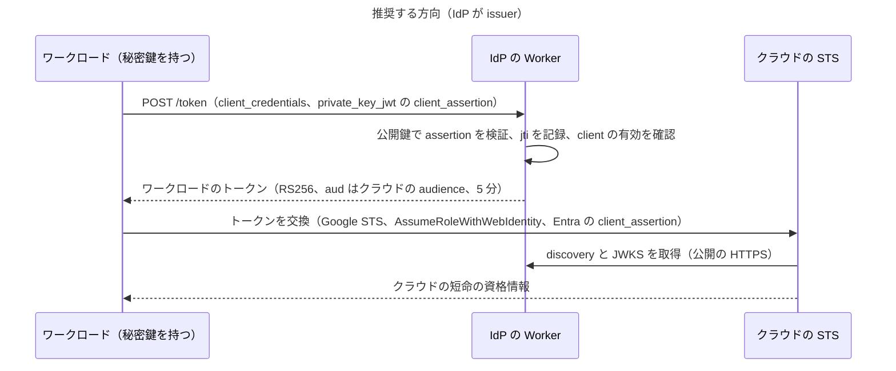

# Workload Identity Federation の実現可能性

Nov 13, 2026 · 調査と設計だけ（実装しない）

人ではないワークロード（自分のサーバー、Worker、バッチ）が、この IdP の発行するトークンでクラウドの短命の資格情報を得られるか（Workload Identity Federation、以下 WIF）を調べ、方向、必要な変更、段階的な PR の計画を記録する。この文書の PR はコードを動かさない。運用者のレビューを経るまで、ここに書いた変更はどれも決定ではない。

## 結論

**条件付きで進める（go-with-conditions）。** 方向は「IdP が外部のクラウドに信頼される OIDC の issuer になる」の 1 つにする。条件は次の 3 つ。

1. **署名に RS256 を使う**：対象のクラウドはどれも Ed25519（`EdDSA`）を受け付けない（下の「プロバイダーの要件」）。WIF を使うデプロイは、既存の任意の機能である RS256 を有効にし、ワークロードのトークンを RS256 で署名する。新しい鍵の種類は足さない。
2. **ワークロードの認証は `private_key_jwt`（RFC 7523）だけ**：ワークロードは手元で生成した鍵の秘密鍵を持ち、IdP は公開鍵だけを持つ。IdP は新しい秘密を発行しない。
3. **カスタムドメインのモードを推奨し、`workers.dev` では接続前に BIC の確認を必須にする**（下の「`workers.dev` とカスタムドメイン」）。

WIF で得られるのは「秘密をなくすこと」ではなく、「クラウドごとの長命の鍵（AWS のアクセスキー、Google Cloud のサービスアカウントキー、Entra のクライアントシークレット）を、ワークロードごとに 1 本の、IdP だけが信頼する鍵に置き換え、クラウドの資格情報を短命にすること」である。ワークロードがすでにクラウドの組み込みの身元（GitHub Actions の OIDC、クラウドの VM のメタデータ）を持つなら、この IdP を挟まずにそれを直接クラウドにつなぐほうがよい。

## WIF の意味と方向

| 方向 | 中身 | 判断 |
| --- | --- | --- |
| A. IdP が issuer（クラウドが IdP を信頼する） | IdP がワークロードに JWT を発行し、Google Cloud、AWS、Entra がそれを検証してクラウドの資格情報と交換する | **推奨**。IdP が外へ通信しない今の形を保ち、足すのは `/token` の 1 つのグラントだけ |
| B. IdP が外部のトークンを受け付ける（IdP が GitHub Actions などを信頼する） | GitHub Actions の OIDC のトークンを RFC 8693 のトークン交換で受け取り、IdP のトークンを発行する | **今は採らない**。下記 |

方向 B を採らない理由：

- GitHub Actions のトークンは、そのままクラウドの WIF に渡せる（issuer は `https://token.actions.githubusercontent.com`、署名の例は RS256。GitHub「OpenID Connect reference」）。IdP を間に挟んでも、クラウドへの接続では得るものがない。
- IdP が外部の JWKS を取りに行く外向きの通信、外部の鍵の RS256 の検証、外部の issuer ごとの信頼の設定（どの `sub` を信じるか）が増える。今の IdP は外へ通信しない（[全体構成](README.md)）ので、攻撃面が戻ってくる（[将来拡張](future-extensions.md)の冒頭の方針）。
- 受け取る価値があるのは、IdP の RP（自分のアプリ）を GitHub Actions から呼ぶ場合だけで、それは認可レベル 3（API 向けのトークン）が前提になる。認可レベル 3 を足すときに、方向 A の後で再検討する。
- 方向 A の後に B を足すと、GitHub Actions は鍵を持たずに IdP のトークンを得られる（`private_key_jwt` の代わりに RFC 7523 §2.1 の JWT bearer か RFC 8693）。その時点の候補として「将来」に残す。

**Cloudflare**：Cloudflare の API が外部の issuer の OIDC のトークンを受け付けてアクセスを許す仕組み（API の WIF）は、公式のドキュメントに見つからなかった。API の資格情報は API トークンと Global API key（Cloudflare「Cloudflare API」）で、Access のサービストークンも Client ID と Client Secret の静的な組である（Cloudflare「Service tokens」）。Cloudflare は対象外とする。Access が任意の外部の issuer の JWT をワークロードの資格情報として受け付けるかは、確かめていない（前提 3）。

## プロバイダーの要件

公式のドキュメントで確かめた要件。調査日は 2026-11-13。

| 要件 | Google Cloud WIF | AWS IAM OIDC + AssumeRoleWithWebIdentity | Microsoft Entra（federated identity credential） |
| --- | --- | --- | --- |
| 署名のアルゴリズム | RS256 か ES256 だけ（G1、G2） | RS256、RS384、RS512、ES256、ES384、ES512（A1、A3） | RS256 だけを支援。ほかは「動くかもしれないが試験していない」（M1） |
| Ed25519 / `EdDSA` | 受け付けない | 一覧にない | 支援しない |
| 必須のクレーム | `iss`、`sub`、`aud`、`exp`、`iat`。`exp` は `iat` の 24 時間以内（G1） | `iss`（登録した URL と一致）、`aud`（登録した audience と一致。`azp` があれば `azp` を使う）、`iat`（A1）。`exp` には 5 分の時刻のずれを許す（A4） | `iss`、`sub`、`aud` を、登録した値と大文字小文字を区別して完全一致で比べる（M2、M3） |
| audience | 既定はプロバイダーの URL（`//iam.googleapis.com/projects/…/providers/…`）。許可する audience を別に登録できる（G1） | 登録時の Audience（client ID）。最大 100 個（A1） | 推奨は `api://AzureADTokenExchange`。1 つの資格情報にちょうど 1 つ（M2、M3） |
| `sub` の制約 | `google.subject` へのマッピングは 127 バイトまで（G4） | 長さの上限は記載なし。トークン全体は 4〜20,000 文字（A3） | 600 文字まで。ワイルドカードなし（M3）。柔軟な一致の式はプレビュー（M2） |
| トークンの寿命 | 入力のトークンの `exp` を検証し、STS のトークンは入力と同じ長さで最大 1 時間（G1） | 入力の上限の記載なし。セッションは 900〜43,200 秒（A3） | 外部のトークンの上限の記載なし（未確認） |
| discovery と JWKS | issuer に `/.well-known/openid-configuration` を付けて取得し、公開のインターネットから届く必要がある。自己署名の証明書の JWKS は不可。JWK に `x5c`、`x5t` を入れない。公開できない issuer は JWKS を最大 8 鍵まで直接アップロードできる（G1、G3） | issuer は `https://` で始まり、大文字小文字を区別し、パスを持てる（クエリは不可）。discovery には `issuer`、`jwks_uri`、`claims_supported`、`response_types_supported`、`subject_types_supported`、`id_token_signing_alg_values_supported` が要る。JWKS に秘密のメンバーがあれば拒否（A1） | issuer の URL から鍵を取得し、最初の 100 鍵だけを保存する（M3） |
| TLS と thumbprint | 公開の CA の証明書（G3） | 公開のルート CA につながる証明書なら thumbprint は使われない。取得できないときや TLS 1.3 が必須のときは thumbprint に戻る。thumbprint は 1〜5 個（A2） | 記載なし |
| 登録の上限 | 記載を確かめていない | issuer の URL はアカウントで一意（A1） | 1 つのアプリかマネージド ID に 20 個（M2） |

出典の記号：

- G1：[Configure Workload Identity Federation with other identity providers](https://docs.cloud.google.com/iam/docs/workload-identity-federation-with-other-providers)
- G2：[STS `token` method](https://docs.cloud.google.com/iam/docs/reference/sts/rest/v1/TopLevel/token)
- G3：[Troubleshoot Workload Identity Federation](https://docs.cloud.google.com/iam/docs/troubleshooting-workload-identity-federation)
- G4：[REST Resource: workloadIdentityPools.providers](https://docs.cloud.google.com/iam/docs/reference/rest/v1beta/projects.locations.workloadIdentityPools.providers)
- A1：[Create an OpenID Connect (OIDC) identity provider in IAM](https://docs.aws.amazon.com/IAM/latest/UserGuide/id_roles_providers_create_oidc.html)
- A2：[Obtain the thumbprint for an OpenID Connect identity provider](https://docs.aws.amazon.com/IAM/latest/UserGuide/id_roles_providers_create_oidc_verify-thumbprint.html)
- A3：[AssumeRoleWithWebIdentity](https://docs.aws.amazon.com/STS/latest/APIReference/API_AssumeRoleWithWebIdentity.html)
- A4：[OIDC federation](https://docs.aws.amazon.com/IAM/latest/UserGuide/id_roles_providers_oidc.html)
- M1：[Important considerations and restrictions for federated identity credentials](https://learn.microsoft.com/en-us/entra/workload-id/workload-identity-federation-considerations)
- M2：[Configure an app to trust an external identity provider](https://learn.microsoft.com/en-us/entra/workload-id/workload-identity-federation-create-trust)
- M3：[federatedIdentityCredentials overview](https://learn.microsoft.com/en-us/graph/api/resources/federatedidentitycredentials-overview)
- M4：[OAuth 2.0 client credentials flow（`client_assertion` による交換）](https://learn.microsoft.com/en-us/entra/identity-platform/v2-oauth2-client-creds-grant-flow)

**アルゴリズムの結論**

- 3 つすべてに通るのは RS256 だけ。ES256 は Google Cloud と AWS に通るが、Entra では「試験していない」扱いになる。
- IdP にはすでに RS256 の任意の機能がある（[トークン設計](tokens.md)の「RS256（任意の機能）」）。鍵の生成、Worker Secret、ローテーション、JWKS と discovery の導出、fail-closed の規則がそのまま使える。ES256 を足すと、鍵の種類が 3 つになり、契約、生成スクリプト、ローテーション、JWKS、検証の結び付け（RFC 8725 §3.1）をすべて増やすことになる。
- そのため、ワークロードのトークンは RS256 で署名する。ES256 は、RS256 の署名の CPU 時間が無料枠に収まらないと実測でわかったときの代わりの候補にする（下の「無料枠」、決定 2）。
- Ed25519 を既定とする方針は人の ID トークンとアクセストークンでは変えない。

**discovery の食い違い（要確認）**

- AWS は discovery に `response_types_supported` を求め、例は `id_token` を載せている（A1）。IdP は `["code"]` を載せ、implicit を広告しない（[標準準拠](standards-compliance.md)）。`code` だけでプロバイダーを作れるかは確かめていない（前提 1）。通らなくても `id_token` は足さない。足すと実装していない implicit を広告することになるため。その場合は WIF の AWS 対応を見送るか、運用者が判断する（決定 9）。
- AWS は `id_token_signing_alg_values_supported` を読む。Ed25519 だけのデプロイ（既定）では `["Ed25519"]` になり、AWS の一覧と交わらない。WIF を使うデプロイは RS256 を有効にして `["Ed25519", "RS256"]` にする。

## `workers.dev` とカスタムドメイン

- **issuer は動かせない**：クラウドは issuer の URL を完全一致で登録する（A1、M3）。ホスト名を移すと、すべてのクラウドで信頼の設定を作り直すことになる。これは RP の issuer の固定（[ホスティングのモード](hosting-modes.md)の 2.3）と同じ性質で、WIF のクラウドが増えるほど移す費用が増える。
- **Browser Integrity Check**：`workers.dev` へのすべての要求は BIC を受け、無効にできない（[無料枠](free-tier.md)、[ホスティングのモード](hosting-modes.md)の 2.4）。クラウドの STS が discovery と JWKS を取りに来る要求が BIC で拒否されるかは確かめていない（前提 2）。拒否されると、トークンの交換が失敗する（安全側の失敗）。Google Cloud は JWKS を直接アップロードできる（G1）ので回避できるが、鍵のローテーションのたびに手でアップロードし直す運用になる。
- **TLS**：どちらのモードも Cloudflare が公開の CA の証明書を出すので、Google Cloud の自己署名の禁止（G3）と、AWS の thumbprint を使わない条件（A2）を満たす見込み。AWS が thumbprint に戻る条件の 1 つ（TLS 1.3 が必須のとき）に当たらないよう、IdP の最小の TLS の版を 1.3 にしないことを確かめる（前提 4）。
- 推奨はカスタムドメインのモード。`workers.dev` では、接続するクラウドごとに BIC を通るかを最初に確かめる（決定 8）。

## ワークロードがトークンを得る方法

ワークロードはパスキーを持たないので、`/authorize` を使わない。比べた選択肢：

| 方法 | 標準 | 判断 | 理由 |
| --- | --- | --- | --- |
| client credentials + `private_key_jwt` | RFC 6749 §4.4、RFC 7523 §2.2、OIDC Core §9 | **採る** | 標準の client 認証の方式。IdP は公開鍵だけを持ち、漏れても困る値を保管しない。RFC 9700 §2.5 は非対称の client 認証を推奨している |
| client credentials + `client_secret_basic` | RFC 6749 §2.3.1 | 採らない | IdP がシークレットのハッシュを持ち、ワークロードとの共有の秘密になる。漏れた値は IdP を経ずにどこからでも使える点は鍵と同じだが、`private_key_jwt` なら assertion の短い寿命と `jti` で 1 回ごとに使い捨てにできる |
| RFC 9421 で署名した `/token` の要求 | RFC 9421 | 採らない | RFC 9421 は client 認証の方式として登録されておらず（`token_endpoint_auth_method` の値がない）、使うと独自の拡張になる（設計原則 3）。管理 API の署名の検証器を流用できる利点より、標準からの逸脱の不利が大きい |
| RFC 8705（mTLS の client 認証） | RFC 8705 | 採らない | クライアント証明書の検証はゾーンの設定が要り、IdP はゾーンのルールを持たない（[ドメインの置き場所](domain-placement.md)の決定 ③）。`workers.dev` では使えない |
| RFC 8693 のトークン交換 | RFC 8693 | 今は採らない | 交換の元になる外部のトークンを受け付けることになり、方向 B と同じ問題を持つ |

**`private_key_jwt` の規則**

- assertion は RFC 7523 §3 に従い、`iss` と `sub` は client ID、`exp` と `jti` を必須にする。
- `aud` は IdP の issuer の文字列 1 つだけを受け付け、トークンエンドポイントの URL や配列は拒否する。draft-ietf-oauth-rfc7523bis は、client 認証の `aud` を issuer 識別子だけにしなければならず（MUST）、トークンエンドポイントの URL を使ってはならない（MUST NOT）とし、これは以前の規定の脆弱性への対処である（[draft-ietf-oauth-rfc7523bis](https://datatracker.ietf.org/doc/draft-ietf-oauth-rfc7523bis/)）。OIDC Core §9 の旧来の記述（トークンエンドポイントの URL）より厳しい側を選ぶ。
- `exp` は `iat` から 5 分以内のものだけを受け付ける。`jti` は D1 に `exp` まで保存し、同じ `jti` の 2 回目を拒否する（管理 API の `nonce` と同じ形。[データモデル](data-model.md)の `admin_request_nonces`）。
- assertion の署名のアルゴリズムは `Ed25519` だけにする。IdP の JWS の検証器がすでに持ち（[標準準拠](standards-compliance.md)）、ワークロードの側（Go、Workers の WebCrypto）でも扱える。`alg` と鍵の種類の結び付け、ヘッダーのメンバーの制限（`alg`、`kid`、`typ` だけ）は既存の規則と同じにする。
- 公開鍵は登録した JWK だけを使う。RFC 7591 の `jwks_uri`（client の鍵を URL から取る）には対応しない。IdP から外へ通信しないため。
- discovery の `token_endpoint_auth_signing_alg_values_supported` は `["Ed25519"]` にする。OIDC Discovery 1.0 §3 は RS256 の支援を推奨（SHOULD）しているので、その例外を[標準準拠](standards-compliance.md)に記録する。

**発行するトークン**

| 項目 | 値 | 理由 |
| --- | --- | --- |
| 形式 | JWT、`typ: JWT`、`alg: RS256` | 3 つのクラウドが共通に受け付ける形。`at+jwt` にしないのは、IdP の `/userinfo` で使うアクセストークンと区別するため |
| `iss` | issuer | クラウドが完全一致で比べる |
| `sub` | `workload:<client_id>` | 決定 4。人の `sub`（UUIDv4）と名前空間が交わらない。client ID は 3〜64 文字で再利用されない（[クライアントの種類](clients.md)）ので、`google.subject` の 127 バイト（G4）と Entra の 600 文字（M3）に収まる |
| `aud` | client に登録した audience の 1 つ（文字列） | Entra はちょうど 1 つを求める（M2）。配列にしない |
| `exp` | `iat` + 5 分 | 今のトークンの方針（[トークン設計](tokens.md)）と同じ。Google Cloud の上限（24 時間、G1）に収まり、交換の直前に取るので短くてよい |
| `iat`、`jti` | 常に入れる | `iat` は Google Cloud と AWS が求める（G1、A1）。`jti` はクラウドの監査ログと IdP のログを結び付けるため |
| 入れないもの | `nonce`、`auth_time`、`name`、`scope`、`client_id`、`azp` | 人のサインインを意味するクレームを入れない。AWS は `azp` があると `aud` の代わりに使う（A1）ので、食い違いを起こさないよう入れない |

- トークンは `/token` のトークンレスポンスの `access_token` として返し（RFC 6749 §4.4.3）、`token_type` は `Bearer`、`expires_in` は 300 にする。ID トークンとリフレッシュトークンは返さない。
- audience の選び方は、client に audience が 1 つなら要求の指定なし、複数なら RFC 8707 の `resource` で選ぶ。`resource` は絶対 URI でなければならず、Google Cloud の既定の audience（`//iam.googleapis.com/…`）は絶対 URI ではないので、Google Cloud では `https://iam.googleapis.com/…` の形を許可する audience として登録してもらう（G1 は許可する audience の登録を認めている）。最初の段階は 1 つの client に 1 つの audience だけにする（決定 5）。

**IdP の中での混同を防ぐ**

- ワークロードのトークンは `typ: JWT` で、IdP 自身が署名するので、IdP の中の検証器に誤って通る経路を閉じる。
  - `id_token_hint`（RP-Initiated Logout、`/authorize`）は、`sub` が `workload:` で始まるトークンと、`auth_time` のないトークンを拒否する。
  - `/userinfo` は今も `typ: at+jwt` と `aud` が issuer のものだけを受け付けるので、変更は要らない。
  - 登録の時点で、audience が issuer と同じ値か、どこかの client ID と同じ値なら拒否する。ID トークンの `aud`（client ID）との衝突をなくすため。
- ワークロードの client は `/authorize` を使えない（client の種類で拒否する）。人の client は `client_credentials` を使えない。

## セキュリティへの影響

[スコープ](scope.md)の「パスキーが唯一の認証手段」は人についての決定で、WIF はそれを変えない。人は引き続きパスキーだけでサインインし、ワークロードは `/authorize` にも、セッションにも、`/userinfo` にも触れない。スコープの表は、パスキーの行を「人の唯一の認証手段」と書き直し、WIF の行を足す（追従する変更）。

[セキュリティ要件チェックリスト](security-checklist.md)に足す項目（e2e の攻撃ケース）：

- `client_credentials` は、ワークロードの client が `private_key_jwt` で認証したときだけ受け付ける。人の client、無効な client、公開鍵が 1 つもない client は `invalid_client` で拒否する
- assertion の `aud` が issuer の文字列 1 つでない（トークンエンドポイントの URL、配列）ものを拒否する
- 同じ `jti` の 2 回目、`exp` が `iat` から 5 分を超えるもの、期限切れのものを拒否する
- `alg` が `Ed25519` でない assertion、鍵の種類と合わない `alg`、`jwk`、`jku`、`x5u`、`crit` を持つヘッダーを拒否する
- 失効させた公開鍵の assertion を拒否する
- ワークロードのトークンを `id_token_hint` と `/userinfo` が拒否する
- RS256 が無効なデプロイでは、ワークロードの client の登録を拒否する。RSA の鍵がなければ発行を失敗させ、別のアルゴリズムで代わりに署名しない（今の RS256 の fail-closed の規則と同じ）
- ワークロードのトークンに `nonce`、`auth_time`、`azp` を入れない

リスクと補い：

| リスク | 影響 | 補い |
| --- | --- | --- |
| ワークロードの秘密鍵の漏えい | 漏れた鍵で、信頼の設定が許す範囲のクラウドの資格情報を得られる | 鍵の失効（`client_key_revoke`）か `client_disable` で、次の発行から止まる。すでに発行したトークンは 5 分、クラウドの資格情報はクラウドの側の寿命（Google Cloud は最大 1 時間、G1）だけ残る。クラウドの側の権限を最小にする |
| IdP の RSA の署名鍵の漏えい | 任意の `sub` のトークンを作れ、信頼を設定したすべてのクラウドに入れる | 今の RS256 の鍵の扱い（1Password と Worker Secret、平文をディスクに書かない）に従う。人の ID トークンの漏えいより影響が広くなることを運用者が受け入れる（決定 1） |
| 権限の根拠がクラウドの外の IdP に移る | IdP で client を作れる管理者が、クラウドの権限を持つワークロードを名乗れる | クラウドの信頼の設定は `sub` を完全一致で指定する（`workload:<client_id>`）。新しい client を作るだけでは既存の信頼に一致しない。client ID は再利用されない |
| 管理者の誤った登録 | 別のクラウドの audience をワークロードに付ける | audience の変更を監査ログに残す（下）。クラウドの側の `sub` の一致がもう 1 つの関門になる |

## 足りないもの

**署名の鍵と無料枠**

- 新しい鍵の種類は要らない。WIF を使うデプロイは RS256 を有効にする（今の手順のまま）。
- RSA 4096 bit の署名の CPU 時間は、[未決事項](open-questions.md)で実測が残っている項目で、無料枠の上限は 1 要求あたり 10 ms（[無料枠](free-tier.md)）。ワークロードの `/token` は、Ed25519 の assertion の検証 1 回と RSA の署名 1 回を行う。実測で収まらなければ、ES256 の鍵を足すか（決定 2）、WIF を見送る。
- D1 の書き込みは、発行 1 回あたり `jti` の行（索引を含めて 2 行）と監査ログの 1 行（決定 7）で、期限切れの `jti` の削除を合わせてならして約 4 行。10 個のワークロードが 5 分ごとに取ると 1 日 2,880 回で約 11,500 行になり、1 日 10 万行の上限の 1 割強を使う。リクエストは 1 日 2,880 件で、10 万件の上限に対して小さい。ワークロードはトークンを使い切るまで取り直さない（クラウドの資格情報が切れるときだけ取る）ことを利用者向けの手順に書く。
- Rate Limiting バインディングは `/token` をすでに数える（[無料枠](free-tier.md)）。assertion の検証の前に数えるので、検証の CPU 時間も守られる。

**データモデル**（[データモデル](data-model.md)に、次の番号のマイグレーションとして足す）

- `clients.client_type` に `workload` を足す。`workload` は `secret_hash` と redirect URI を持たない。`CHECK` 制約を変えるので表の作り直しになる（`0004` の注意書きと同じ）。
- `client_keys`：ワークロードの公開鍵（JWK、`kid` は RFC 7638 の thumbprint、追加の時刻）。失効は追記だけの出来事の表で持ち、行を消さない。1 つの client に有効な鍵は最大 2 本（ローテーションの間だけ 2 本）。
- `client_audiences`：client ごとに許可する audience の一覧（最初の段階は 1 つ）。
- `client_assertion_jtis`：`(client_id, jti)` を主キーにし、`expires_at` を持つ。管理 API の `nonce` と同じく、発行時に期限切れの行を消す。
- `sub` は表に持たず、`workload:` と client ID から導く。

**管理 API と `idpctl`**（[管理 CLI と管理用の Worker](idpctl.md)）

- `client_create --workload --audience <aud> --jwk-file <公開鍵の JWK>`：ワークロードの client を作る。秘密は発行しないので、0600 のファイルへの書き出しはない。RS256 が無効なら拒否する。
- `client_key_add`、`client_key_revoke`：公開鍵のローテーションと失効。
- `client_set_audiences`：audience の変更。
- 操作は「RP の管理」に分類する（[認可](authorization.md)の管理の関心事）。権限を広げる操作として、`client_key_add` と `client_set_audiences` は新しい値（`kid`、audience）を `detail_json` に残す。audience と `kid` は個人情報を含まない設定値。
- 鍵の生成は `idpctl` でも管理用の Worker でもしない。ワークロードの側で生成し、公開鍵だけを渡す（今の「鍵は生成スクリプトで作る」規則に合わせ、生成の手順はリポジトリのスクリプトとして足す）。

**監査**

- 今は、IdP の Worker は本人のパスキー操作だけを監査ログに書き、サインインは書かない（[データモデル](data-model.md)）。
- ワークロードへの発行は、クラウドの資格情報を作る操作なので、成功した発行ごとに `actor` を新しい値 `workload`、`operation` を `workload_token_issue`、`target` を `client:<id>` とする行を書くことを提案する（決定 7）。`detail_json` には `kid`、audience、`jti` を入れ、トークンそのものは入れない。失敗の行は書かない（認証前の要求で書き込みの上限を使わせないため。今の規則と同じ）。
- クラウドの側でも、Google Cloud の監査ログ、CloudTrail、Entra のサインインのログに `sub` と `jti` が残る。

## 標準を先に置く方針との整合

[標準の実装のパッケージへの分割](packages.md)の規則に従い、標準のロジックは `@idp` のスコープの平らなパッケージに置く。

| パッケージ | 規格 | 中身 | 依存 |
| --- | --- | --- | --- |
| `@idp/jwt-client-auth`（新規） | RFC 7523 §3、RFC 7521 §4.2、draft-ietf-oauth-rfc7523bis | client assertion のクレームの検証（`iss` = `sub`、`aud` が issuer の文字列 1 つ、`exp`、`jti` の形、寿命の上限）。鍵の取り出しと `jti` の保存はポートとして受け取る | jws |
| `@idp/jws`（既存） | RFC 7515、RFC 7518 | RS256 の署名はすでにある。変更なしの見込み | base64url |
| `@idp/oidc-discovery`（既存） | OIDC Discovery 1.0 §3、RFC 8414 | `token_endpoint_auth_signing_alg_values_supported` の型を足す | なし |
| `@idp/resource-indicators`（複数の audience にするときだけ） | RFC 8707 | `resource` の形（絶対 URI、フラグメントなし）の検証 | なし |

IdP 固有の方針（`workload:` の `sub`、audience の登録の規則、ワークロードの client の制約）は、`packages/core/src/clients/` と `src/user/` に置く。`jti` の保存は D1 のポートとして core と `packages/d1-adapter` に置く。

## 段階的な PR の計画

運用者がこの文書を承認した後に、次の順で進める。

1. **設計の反映**（文書だけ）：決定を[スコープ](scope.md)、[トークン設計](tokens.md)、[クライアントの種類](clients.md)、[標準準拠](standards-compliance.md)（`token_endpoint_auth_signing_alg_values_supported` の例外）、[セキュリティ要件チェックリスト](security-checklist.md)、[データモデル](data-model.md)、[管理 CLI と管理用の Worker](idpctl.md)、[未決事項](open-questions.md)に書き移す。
2. **`@idp/jwt-client-auth`**：パッケージとテスト（RFC 7523 の規則の境界の値）。
3. **契約とマイグレーション**：`client_type` の `workload`、`client_keys`、`client_audiences`、`client_assertion_jtis`、テストベクタ。
4. **管理用の Worker と `idpctl`**：`client_create --workload`、`client_key_add`、`client_key_revoke`、`client_set_audiences`、OpenAPI、監査ログ。
5. **IdP の Worker**：`/token` の `client_credentials`、discovery の追加の値、`id_token_hint` の拒否の規則、監査ログの行。
6. **e2e**：上のチェックリストの攻撃ケース。両方のホスティングのモードで流す。
7. **CPU 時間の実測とクラウドとの接続**（運用者の作業）：RS256 を有効にしたデプロイで `/token` の CPU 時間を測り、Google Cloud、AWS、Entra のうち使うものに信頼を設定して、交換が通ることと、前提 1、2、4 を確かめる。エージェントは `cf`、Terraform の apply、デプロイを実行しない。

## 運用者に決めてもらうこと

1. **方向と採否**：方向 A（IdP が issuer）だけで進めるか。IdP の RSA の鍵の漏えいがクラウドの権限に及ぶことを受け入れるか。
2. **署名のアルゴリズム**：RS256 を使い回す（推奨）か、ES256 の鍵を新たに足すか。Entra を使わないなら ES256 も選べる。
3. **ワークロードの認証**：`private_key_jwt` と `Ed25519` の assertion だけにするか（推奨）。ES256 の assertion も受け付けるか。
4. **`sub` の形**：`workload:<client_id>`（推奨）か、人と同じ UUIDv4 か。
5. **audience**：最初は 1 つの client に 1 つ（推奨）か、最初から RFC 8707 の `resource` で複数を選べるようにするか。
6. **寿命**：ワークロードのトークンを 5 分（推奨）にするか。
7. **監査**：発行ごとに監査ログに 1 行を書くか（推奨。D1 の書き込みが増える）、Worker のログとクラウドの監査ログに任せるか。
8. **ホスティングのモード**：WIF をカスタムドメインのモードに限るか、`workers.dev` でも BIC の確認を条件に許すか。
9. **AWS の discovery**：AWS が `response_types_supported: ["code"]` を受け付けないとわかったとき、AWS の対応を見送るか（推奨）、別の手段を検討するか。

## 前提

調査で確かめられなかったことは、次の前提を置いて設計した。

1. AWS は、discovery の `response_types_supported` が `["code"]` でも OIDC のプロバイダーを作れる（A1 の例は `id_token` だが、それしか許さないとは書かれていない）。
2. クラウドの STS が discovery と JWKS を取りに来る要求が、`workers.dev` の BIC で拒否されるかはわからない。拒否されうるものとして、カスタムドメインを推奨した。
3. Cloudflare Access が任意の外部の issuer の JWT をワークロードの資格情報として受け付けるかは確かめていない。Cloudflare の API には WIF の仕組みがないとして対象外にした。
4. IdP の最小の TLS の版は 1.2 のままで、AWS の thumbprint に戻る条件（TLS 1.3 が必須）に当たらない。
5. Google Cloud の要件は、公式のドキュメントのページの取得がこの調査の環境で許されなかったので、Google の公式のドキュメントの検索結果の抜粋で確かめた。実装の前に G1〜G4 を読み直す。
6. Entra が外部のトークンの `exp` と寿命の上限をどう扱うかは記載がなく、5 分のトークンで交換できると置いた。
7. 「ワークロード」は、運用者が自分で動かすサーバー、Worker、バッチで、組み込みの身元（GitHub Actions の OIDC、クラウドの VM のメタデータ）を持たないものとした。

## 出典

プロバイダーの出典は上の「出典の記号」を参照。ほかに：

- [GitHub「OpenID Connect reference」](https://docs.github.com/en/actions/reference/security/oidc)（issuer、署名の例、`sub` の形）
- [Cloudflare「Cloudflare API」](https://developers.cloudflare.com/fundamentals/api/)、[Cloudflare「Service tokens」](https://developers.cloudflare.com/cloudflare-one/access-controls/service-credentials/service-tokens/)
- [RFC 7523：JWT Profile for OAuth 2.0 Client Authentication and Authorization Grants](https://www.rfc-editor.org/rfc/rfc7523)、[RFC 7521：Assertion Framework](https://www.rfc-editor.org/rfc/rfc7521)
- [draft-ietf-oauth-rfc7523bis：Updates to Audience Values for OAuth 2.0 Authorization Servers（Internet-Draft）](https://datatracker.ietf.org/doc/draft-ietf-oauth-rfc7523bis/)
- [RFC 8693：OAuth 2.0 Token Exchange](https://www.rfc-editor.org/rfc/rfc8693)、[RFC 8707：Resource Indicators](https://www.rfc-editor.org/rfc/rfc8707)、[RFC 8705：Mutual-TLS Client Authentication](https://www.rfc-editor.org/rfc/rfc8705)
- [OpenID Connect Core 1.0 §9（client 認証）](https://openid.net/specs/openid-connect-core-1_0.html#ClientAuthentication)、[OpenID Connect Discovery 1.0 §3](https://openid.net/specs/openid-connect-discovery-1_0.html#ProviderMetadata)
- [RFC 9700 §2.5（client 認証）](https://datatracker.ietf.org/doc/html/rfc9700)
