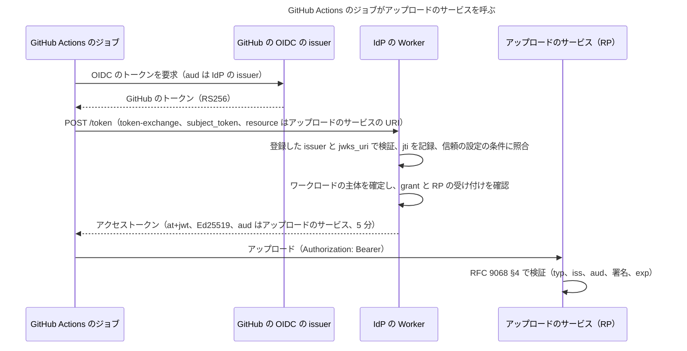
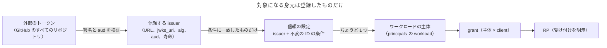

# Workload Identity Federation（外部のワークロードを自分の RP につなぐ）

Nov 13, 2026 · 調査と設計だけ（実装しない）

外部の基盤（GitHub Actions、GitLab CI、Kubernetes、クラウドの VM など）で動くワークロードが、その基盤の発行する OIDC のトークンをこの IdP で交換し、この IdP に登録した RP だけが受け付けるトークンを得る仕組み（Workload Identity Federation、以下 WIF）を設計する。長命の秘密をワークロードに置かずに済ませることが目的。この文書の PR はコードを動かさない。運用者のレビューを経るまで、下の変更はどれも決定ではない。

動機の例：ファイルのアップロードのサービスがこの IdP の RP になっている。GitHub Actions のジョブが、自分の GitHub の OIDC のトークンを IdP に示して、アップロードのサービスあてのトークンと交換し、アップロードする。ジョブにはアップロードのサービスの API キーも IdP のシークレットも置かない。

## 結論

**条件付きで進める（go-with-conditions）。** 外部のトークンを受け付ける方向は、下の条件を守れば[スコープ](scope.md)の「ほかのサービスの認証に影響しない」原則を満たす。満たしきれない点は 1 つだけ残り（「原則に照らして残る点」の R1）、それはワークロードの側の設定の誤りで起き、IdP が拒否することで影響を IdP の中にとどめる。

条件：

1. **交換は RFC 8693 のトークン交換**で行い、発行するのは RFC 9068 の JWT アクセストークン（`typ: at+jwt`、`Ed25519`）だけにする。
2. **宛先は IdP に登録し、ワークロードのトークンを受け付けると明示した RP だけ**。`resource`（RFC 8707）は、その RP に登録した URI との完全一致だけを受け付ける。外部の宛先への委譲や交換はしない。
3. **信頼の単位は issuer ではなく「issuer + 不変の ID の条件」**。issuer だけの信頼の設定は登録の時点で拒否する。
4. **外部の issuer への通信は、運用者が登録した `jwks_uri` への GET だけ**。外部の基盤に書き込まず、外部の基盤の上で何もしない。
5. **信頼の設定はリポジトリでレビューするデプロイの入力に置き**、盗まれた管理者の鍵では足せないようにする（脅威モデルの T9）。WIF そのものも、デプロイの入力で有効にする任意の機能にし、既定は無効にする（T11）。
6. 実装は、いま進んでいる標準パッケージの分割（[packages.md](packages.md)、ワーカー wNM）が終わってから始める。

## 原則との照合

[スコープ](scope.md)の冒頭に置いた原則：この IdP は趣味のプロジェクトで、セキュリティと統制は確立した製品より弱い。そのため、ほかのサービスの認証に影響しうる機能は入れない。IdP が侵害されても、影響はこの IdP を信頼すると決めた自分の RP の中にとどまらなければならない。

| 設計の部分 | 原則との関係 | 守り方 |
| --- | --- | --- |
| 発行するトークン | 宛先が IdP の外に出ると原則に反する | `aud` は、登録済みでワークロードを受け付けると明示した RP の `resource` の URI だけ。`audience` パラメーター、外部の URI、RFC 8693 の委譲（`actor_token`）は拒否する |
| トークンの形 | 外部のサービスが自分のトークンと取り違えると原則に反する | `iss` は IdP、`typ` は `at+jwt`、署名は `Ed25519` だけ。主要なクラウドの WIF は Ed25519 を受け付けない（付録）。ワークロードのトークンを RS256 で署名する経路は作らない |
| 外部のトークンの受け付け | 読むだけなら原則の内側 | 外部の基盤への通信は、登録した `jwks_uri` への資格情報なしの GET だけ。外部のトークンを外部に転送しない。ログにも監査ログにも残さない |
| IdP の侵害 | 侵害した者は、自分の RP あてのトークンを作れる | 人のトークンと同じで、影響は自分の RP の中。外部の基盤の資格情報を IdP は持たない |

## 流れ

## テナントがないことと、主体の範囲

運用者の問い：「テナントの概念がないので、WIF を足すと、あらゆる身元が対象に入るのではないか」。

答え：**入らない。** GitHub の issuer `https://token.actions.githubusercontent.com` は GitHub のすべてのリポジトリのトークンに署名するので、誰でも正しい署名のトークンを IdP に示せる。しかし、それだけでは何も得られない。対象になるのは、運用者が 1 つずつ登録したワークロードの主体だけで、次の規則で閉じる。

- **テナントは作らない**：IdP の運用者は 1 人で、信頼の境界は 1 つ。テナントの導入は対象外にする。
- **共有の issuer は信頼の境界ではない**：信頼の設定（trust entry）は、issuer と、不変の ID に対する必須の条件の組にする（GitHub なら `repository_id` か `repository_owner_id`）。issuer だけの設定は登録の検証で拒否する。1 つの信頼の設定は、ちょうど 1 つのワークロードの主体に対応する。
- **事前の登録だけ**：どの信頼の設定にも一致しないトークンは `invalid_grant` で拒否し、主体を作らない（初回の利用で主体を作る JIT のプロビジョニングはしない）。
- **ワークロードは新しい種類の主体**：[認可](authorization.md)の主体のモデル（`principals`）に `workload` の種類を足す。アクセスは「主体 × client」の明示の grant だけで得られ、既定では何も得られない（行がなければ拒否。fail-closed）。
- **グループには入れない**：グループは人についての事実で、メンバーにできるとグループへの 1 つの grant が機械にまで広がる。ワークロードには直接の grant だけを付ける。`group_members` はもともと `users` だけを参照するので、外部キーでも防がれる。
- **人とワークロードは交わらない**：ワークロードはパスキーでサインインできず、ID トークンも得られない（`/authorize` を通らない）。人のセッションはワークロードのトークンを得られない（トークン交換はセッションを使わない。IdP 自身を信頼する issuer として登録することを拒否するので、人の ID トークンやアクセストークンを `subject_token` にしても通らない）。
- **RP は明示して受け付ける**：client は、ワークロードのトークンを受け付けるという印（と `resource` の URI）を登録したときだけ、ワークロードの宛先になる。今の RP には何も変わらない。ワークロードのトークンはアクセストークン（`typ: at+jwt`）なので、ID トークンを検証する RP のライブラリは拒否する。

**判定の置き場所について**：オーケストレーターの提案は「`effective_access` で fail-closed にする」だった。今の `effective_access` は `user_id` の列を返し、ユーザーとグループの経路を和集合で持つ（[データモデル](data-model.md)）。ここにワークロードの行を足すと、人の経路（`/authorize`、`/token`、`/userinfo`）の判定にワークロードの行が混ざりうる。そこで、同じ形（有効な主体、有効な client、直接の grant の内部結合）の別のビュー `workload_access` を足し、ワークロードの判定はそちらだけを読むことを提案する（決定 8）。考え方は `effective_access` と同じで、出来事の行がなければ現れない。

## 交換のプロトコル

| 方式 | 判断 | 理由 |
| --- | --- | --- |
| RFC 8693（Token Exchange） | **採る** | `subject_token` と `subject_token_type` で外部のトークンを渡し、`resource` で宛先を選び、`issued_token_type` で発行したものの種類を返す（§2.1、§2.2.1）。宛先を受け付けられないときの `invalid_target` もある（§2.2.2）。クラウドの STS が使う形でもあり、ワークロードの側の道具がそろっている |
| RFC 7523 §2.1（JWT bearer の認可グラント） | 採らない | 外部の JWT を `assertion` に入れる形で、§3 は `aud` が認可サーバーを示すことを求める。使えるが、入力のトークンの種類と発行するトークンの種類を表す標準のパラメーターがなく、`resource` は RFC 8707 に頼る。1 つのグラントで済ませるなら RFC 8693 のほうが表せることが多い |
| draft-ietf-oauth-identity-chaining | 採らない | 信頼のドメイン A の認可サーバーでトークン交換をして、ドメイン B の認可サーバーあての JWT の認可グラントを得る、ドメインをまたぐ形（Abstract、§2）。この IdP で外部のドメインあてのグラントを作ると原則に反する。外部の基盤のトークンを直接 IdP に示す今回の形には当たらない。まだ Internet-Draft である |

**要求の規則**（`/token`、RFC 8693 §2.1）

- `grant_type` は `urn:ietf:params:oauth:grant-type:token-exchange`。
- `subject_token_type` は `urn:ietf:params:oauth:token-type:jwt` だけを受け付ける（§3）。`id_token` は受け付けない。GitHub のトークンは OIDC の ID トークンとして発行されたものではなく、種類を 1 つにして検証の経路を増やさないため（決定 3）。
- `resource` は必須で、ちょうど 1 つ。ワークロードのトークンを受け付けると登録した client の `resource` の URI との完全一致だけを受け付け、それ以外は `invalid_target` にする（RFC 8707 §2、RFC 8693 §2.2.2）。
- `audience` は拒否する（`invalid_target`）。論理名で宛先を指す経路を持たないため。
- `requested_token_type` は、省略か `urn:ietf:params:oauth:token-type:access_token` だけ。
- `actor_token` と `actor_token_type` は拒否する（`invalid_request`）。委譲は扱わない。
- client の認証はしない。RFC 8693 §2.1 は client の認証の方法と、認証しない client を許すかを認可サーバーの判断に任せている。ここでは `subject_token` そのものが資格情報で、主体は信頼の設定との一致で決まる。`client_id` を送られても無視せず、拒否する（主体の決め方を 1 つにするため）。
- discovery の `grant_types_supported` に token-exchange のグラントを足す。

## 信頼の設定

運用者が登録する。IdP の Worker は登録された値だけを使う。登録の場所は決定 16 で決める。推奨は、リポジトリでレビューしてデプロイで反映する入力（デプロイごとの入力の `federation_trust`）に置き、管理 API では変えられないようにすること。盗まれた管理者の鍵で、パスキーのいらない裏口を作らせないため（下の「脅威モデル」の T9）。代わりの案は、管理用の Worker と `idpctl` で登録し、有効になるまでの待ち時間を置く形。どちらでも、規則は共有コアの同じ検証（下の「条件の検証」）で確かめる。

**信頼する issuer**

| 項目 | 規則 |
| --- | --- |
| issuer の URL | `https` の絶対 URI。トークンの `iss` と完全一致で比べる。IdP 自身の issuer は拒否する |
| JWKS の取り先 | 運用者が登録する `jwks_uri`（`https`）だけ。IdP の Worker は discovery を取りに行かない。`idpctl` が運用者の手元で discovery を読んで `jwks_uri` を示し、運用者が確かめて登録する |
| 受け付ける `alg` | `RS256`、`ES256`、`ES384` から選ぶ。GitHub と GitLab は RS256（下の表）。RSA の鍵は 2048 bit 以上だけ（RFC 7518 §3.3） |
| 必須の `aud` | トークンの `aud` がこの 1 つの値だけであること（文字列か、要素が 1 つの配列）。既定は IdP の issuer の URL。ほかの値を含むトークンは拒否する |
| 寿命の上限 | `exp − iat` と、受け取った時点の `iat` からの経過の上限。既定は 10 分、最大 1 時間 |
| 不変の ID のクレーム | その issuer で不変の ID を表すクレームの一覧（GitHub なら `repository_id`、`repository_owner_id`）。信頼の設定は、この一覧のどれかに条件を持たなければ登録できない |

**外部の基盤のトークン**（公式のドキュメントで確かめた値）

| 基盤 | issuer | `alg` | 主な不変の ID | 寿命 | 出典 |
| --- | --- | --- | --- | --- | --- |
| GitHub Actions | `https://token.actions.githubusercontent.com` | 例は RS256 | `repository_id`、`repository_owner_id`、`actor_id`。2026-07-15 より後に作ったリポジトリの既定の `sub` は、所有者の ID とリポジトリの ID を含む不変の形 | 記載なし（例は 5 分） | [GH1]、[GH2] |
| GitLab CI | GitLab のインスタンスのドメイン | RS256 | `project_id`（プロジェクトの間ずっと同じ）、`namespace_id`（今の名前空間にある間は同じ） | ジョブのタイムアウト、なければ 5 分 | [GL1] |
| Kubernetes | クラスターの issuer | RS256、ES256、ES384、ES512（外部の署名器の節） | `sub` は `system:serviceaccount:<名前空間>:<名前>` の名前の形 | 要求で指定。既定は 1 時間 | [K1]、[K2] |
| Google Cloud | `https://accounts.google.com` | RS256 | `sub` はサービスアカウントの一意の ID | 1 時間以内 | [GC1] |
| AWS（GetWebIdentityToken） | アカウントごとの issuer の URL | 要求で指定（例は ES384） | `sub` は IAM の主体の ARN | ポリシーで制御 | [AW1] |
| Azure（マネージド ID） | 確かめていない | 確かめていない | 確かめていない | 例は約 1 時間 | [AZ1] |

- Kubernetes の既定の寿命（1 時間）は既定の上限（10 分）を超えるので、短い寿命を要求してもらうか、その issuer の上限を上げる。名前の `sub` は、同じ名前のサービスアカウントを作り直すと同じ値になるので、クラスターごとに issuer を分けたうえで、名前の再利用を運用で防ぐ前提にする（前提 4）。
- Azure のマネージド ID のトークンは、受け取った資料では issuer、`alg`、`jti` を確かめられなかった。最初の段階では対象にしない（決定 13）。

## ワークロードの身元への対応付け

Google Cloud の属性の条件と AWS の信頼ポリシーにならうが、最小にする。

- **条件の形**：クレームの名前と期待する値の組の一覧で、すべてが一致したときだけ一致とする（AND）。比較は文字列の完全一致だけで、ワイルドカード、前方一致、正規表現、式の言語は持たない。クレームは最上位か、1 段だけ入れ子にしたもの（Kubernetes の `kubernetes.io` の中など）を指せる。値が文字列でないクレームは一致しない。
- **条件の検証**：登録の時点で、共有コアの同じ検証が次を確かめ、通らない設定を拒否する（デプロイの入力なら Worker が起動の時点で拒否し、fail-closed にする）。既知の issuer には最低限の条件の組（プロファイル）を持たせる。
  - GitHub（`https://token.actions.githubusercontent.com`）：`repository_id` の条件と、`ref` か `environment` の条件を必須にする。`event_name` の条件がない設定と、`repository_owner_id` だけでリポジトリを絞らない設定は、明示の承認の印（`acknowledge`）がなければ拒否する。必須の `aud` が GitHub の既定の audience（リポジトリの所有者の URL。[GH1]）の形なら拒否する。
  - GitLab：`project_id` の条件と、`ref` と `ref_protected` = `true`、または `environment_protected` = `true` の条件を必須にする。
  - 既知でない issuer：運用者が宣言した不変の ID のクレームの条件を 1 つ以上必須にする。
- **必須の条件**：少なくとも 1 つは、その issuer の不変の ID のクレームに対する条件にする。GitHub では、名前（`repository`、`repository_owner`）だけの条件は登録できない。名前は付け替えや再利用で別の持ち主のものになりうるため（GitHub は、名前空間が再利用されると別の持ち主が同じ `sub` を作れると注意している。[GH1]）。
- **一致の一意性**：1 つのトークンが、別々のワークロードに対応する 2 つ以上の信頼の設定に一致したら拒否する（fail-closed）。同じワークロードへの複数の設定（GitHub と GitLab の両方など）は許す。
- **主体へ**：一致した信頼の設定が指すワークロードの主体が、トークンの `sub` になる。外部の `sub` は IdP のトークンに入れない。
- **受け取れる先**：そのワークロードに直接付けた grant があり、宛先の client が有効で、ワークロードのトークンを受け付けると明示しているときだけ発行する。スコープは最初の段階では持たない（決定 10）。

**GitHub での例と落とし穴**

- アップロードの例の条件：`repository_id` = アップロードするリポジトリの ID、`ref` = `refs/heads/main`、`event_name` = `push`。
- `pull_request` と `pull_request_target`：フォークからのプルリクエストのワークフローが `id-token: write` を得られるかは、読んだ公式のドキュメントでは確かめられなかった（前提 3）。それに頼らず、`ref` と `event_name`、または保護ルールを付けた `environment` の条件で、レビュー済みの枝からの実行だけに絞る。`pull_request_target` はベースのリポジトリの文脈で動くので、`repository_id` の条件だけでは止まらない。
- 再利用のワークフロー：呼び出し側ではなく、再利用のワークフローそのものに絞るときは `job_workflow_ref` を条件に足す（[GH2]）。
- GitHub は、信頼の設定に少なくとも 1 つの条件を定めなければならない（must）としている（[GH1]）。この設計はそれより強く、不変の ID の条件を必須にする。

## 発行するトークンと RP の検証

| 項目 | 値 | 理由 |
| --- | --- | --- |
| 形式 | JWT、`typ: at+jwt`、`alg: Ed25519`、`kid` | RFC 9068 §2.1。ID トークン（`typ: JWT`）と取り違えない。Ed25519 は主要なクラウドが受け付けない |
| `iss` | IdP の issuer | |
| `sub` | ワークロードの主体の ID（UUIDv4） | RFC 9068 §2.2 は、リソースオーナーのいないグラントでは `sub` を client を表す識別子にすべき（SHOULD）としている。ここではワークロードの主体がその client に当たる |
| `client_id` | `sub` と同じ値 | RFC 9068 §2.2 で REQUIRED。要求した者はワークロード自身 |
| `aud` | 宛先の RP の `resource` の URI（1 つの文字列） | RFC 9068 §3 は `resource` と同じ値にすべき（SHOULD）とし、§5 は宛先ごとに別の値を使わなければならない（MUST）とする |
| `exp` | `iat` + 5 分と、`subject_token` の `exp` の早いほう | 受け取ったトークンより長く生きない |
| `iat`、`jti` | 常に入れる | RFC 9068 §2.2 で REQUIRED |
| 入れないもの | `act`、`may_act`、外部のクレーム、`auth_time`、`nonce`、`scope` | 委譲ではなくワークロード自身が主体なので `act` は使わない（RFC 8693 §4.1）。外部の `sub` などは RP との契約にしない |

- トークンレスポンスは `access_token`、`issued_token_type`（`urn:ietf:params:oauth:token-type:access_token`）、`token_type`（`Bearer`）、`expires_in` を返す（RFC 8693 §2.2.1）。リフレッシュトークンは返さない。
- **RP の検証**（RFC 9068 §4）：`typ` が `at+jwt` か `application/at+jwt` であること、`iss` の完全一致、`aud` に自分の `resource` の URI があること、IdP の JWKS の鍵で `Ed25519` の署名が通ること、`exp` が過ぎていないこと。RP は `sub` を自分の側で許すワークロードの一覧と照らしてもよい。誤りは RFC 6750 §3.1 の `invalid_token`。
- 人のアクセストークンは `aud` が issuer で `/userinfo` だけで使い、RP には届かない（[トークン設計](tokens.md)）。そのため、RP に届く `at+jwt` はワークロードのトークンだけになる。
- **ID トークンとして通さない**：
  - `id_token_hint`（RP-Initiated Logout）は `typ: JWT` だけを受け付けるので、`at+jwt` は拒否される。検証の規則に明記する。
  - `/userinfo` は `aud` が issuer のものだけを受け付ける。`resource` の URI は、issuer と同じ値と、issuer と同じオリジンの URI を登録の時点で拒否する。
  - `resource` は絶対 URI なので、URI の形を持たない client ID（英小文字、数字、ハイフン）と衝突しない。ID トークンの `aud`（client ID）と取り違えられない。
  - RFC 8725 §3.12 は、種類の違う JWT の検証の規則を互いに排他にしなければならない（MUST）としている。`typ`、`aud` の形、`/userinfo` の `aud` の 3 つで排他にする。

## Workers と無料枠

- **外向きの取得**：JWKS の取得は 1 回の交換で多くて 1 回。無料枠の 1 要求あたりのサブリクエストは 50 で、ネットワークの待ちは CPU 時間に数えない（[CF4]）。
- **キャッシュの置き場所**：D1 の 1 行（issuer ごとの JWKS と取得の時刻）と、モジュールスコープの取り込み済みの鍵にする。Cache API は内容がデータセンターの外に複製されず（[CF1]）、`workers.dev` で使えるかも確かめられなかった。KV は無料枠の書き込みが 1 日 1,000 件で、変更がほかの拠点に見えるまで 60 秒以上かかりうる（[CF2]）ので、ローテーションの直後に古い鍵を見続けうる。D1 なら新しいバインディングも要らない。
- **更新の規則**：取得から 1 時間を過ぎたか、見慣れない `kid` を見たときに取り直す。取り直しは issuer ごとに 5 分に 1 回まで（ランダムな `kid` のトークンで外向きの取得を起こさせないため）。取得できないときは、取得から 24 時間以内のキャッシュにその `kid` があれば使い、なければ拒否する（fail-closed）。
- **取得の制限**：登録した `jwks_uri` だけを GET し、リダイレクトに従わず、応答の大きさ（64 KiB）、鍵の数（20）、時間に上限を置く。資格情報やクッキーは送らない。
- **CPU 時間**：RS256 と ES256 の検証 1 回と、Ed25519 の署名 1 回。Workers の Web Crypto は RSASSA-PKCS1-v1_5 と ECDSA の検証を支援する（[CF3]。曲線ごとの記載はない。P-384 は管理用の Worker の検証でローカルに確かめ済み。[未決事項](open-questions.md)）。RSA の検証は署名より軽いが、実測していないので[未決事項](open-questions.md)に足す。
- **D1 の書き込み**：交換 1 回あたり、`jti` の行（索引を含めて 2 行）、期限切れの `jti` の削除、監査ログの 1 行（決定 12）で、ならして約 4 行。CI のジョブが 1 日 100 回なら約 400 行で、1 日 10 万行の上限に対して小さい。JWKS の更新は issuer ごとに 1 日最大 24 行程度。
- **大量の要求**：`/token` は IdP の Worker の Rate Limiting バインディングがすでに数える（[無料枠](free-tier.md)）。数えるのは署名の検証の前。

## セキュリティ

e2e の攻撃ケースにする要件は、[セキュリティ要件チェックリスト](security-checklist.md)の「Workload Identity Federation」の節に W1〜W16 として足した（この文書の承認までは提案）。偽の issuer と JWKS をテストの中で立てて流す。脅威ごとの対策と項目の対応は、次の「脅威モデル」にまとめる。

**監査**

- 交換が成功するたびに、監査ログに 1 行を書く。`actor` は新しい値 `workload`、`operation` は `token_exchange`、`target` は `workload:<id>`。`detail_json` には信頼の設定の ID、宛先の client ID、外部のトークンの `jti` を入れる。外部の `sub` は入れない（リポジトリ名や利用者名を含みうるので、設計原則 7 のとおり持たない）。失敗の行は書かない（認証前の要求で書き込みの上限を使わせないため。[データモデル](data-model.md)の今の規則と同じ）。
- 信頼の設定とワークロードの作成、変更、無効化は、管理操作として今の規則で記録する。権限を広げる操作（信頼の設定の追加、ワークロードへの grant）は、新たに使えるようになったワークロードと client の組を `detail_json` に残す。

## 脅威モデル

ワークロードへの対応で増える攻撃面は 3 つある。認証の前に誰でも呼べるトークン交換のエンドポイント（外部の JWT の解析と署名の検証）、IdP からの外向きの JWKS の取得、外部の身元を信じる信頼の設定（とそれを変える経路）。各脅威の対策と、[セキュリティ要件チェックリスト](security-checklist.md)の項目（W1〜W16）、[スコープ](scope.md)の原則との関係を次にまとめる。

**T1 認証の前の JWT の解析**

- 脅威：`/token` は誰でも呼べ、攻撃者が作った任意の JWT を解析させられる。巨大な入力、深い JSON、巨大な RSA の鍵で、メモリと CPU を使わせる。
- 対策：`subject_token` は 16 KiB まで、3 つの部分の厳格な base64url、ヘッダーとペイロードは大きさと入れ子の深さに上限を置く（W1）。暗号の処理の前に安い確認をすべて済ませる：`iss` が登録済みで有効な issuer か、`alg` がその issuer の許可リストにあるか、`kid` があるか、`aud`、`exp`、`iat`、寿命、条件の照合（W2）。登録していない `iss` は、取得も暗号の処理もせずに拒否する。RSA の鍵は法の長さを 2048〜4096 bit、公開指数を 65537 に限り、EC の鍵は `alg` の曲線と一致させる（W3）。
- 原則：IdP 自身の可用性の問題で、ほかのサービスに及ばない。

**T2 CPU 時間と 1 日のリクエストの上限を使い切らせる**

- 脅威：無料枠の CPU 時間は 1 要求あたり 10 ms で、RSA の検証がそれを使う。1 日のリクエストの上限はアカウント全体で数え、人のサインインと共有する（[無料枠](free-tier.md)）。
- 対策：署名の検証は、W2 の安い確認をすべて通った要求でだけ行う。正しい署名を作れない攻撃者は、登録した issuer と条件に合う `iss`、`aud`、クレームの組を知っていても、RSA の検証を 1 回起こせるだけ。トークン交換は、IdP の Worker の既存の Rate Limiting とは別の名前空間（デプロイごとの入力 `federation_rate_limit_namespace_id`）で、解析の前に接続元の IP ごとに数える。バインディングがないか呼び出しが失敗したら拒否する（W5）。D1 の書き込みは、署名の検証を通った後（`jti` と監査ログ）と、間隔の下限を守った JWKS の更新だけで、認証前の要求では増えない。
- 別の Worker に分けるか：1 日のリクエストの上限はアカウント全体で数えるので、Worker を分けても上限は分けられない。CPU 時間の上限は要求ごとなので、交換の要求が人のサインインの要求の CPU を使うこともない。分けて得られるのはコードとデプロイの分離だけで、Worker とホスト名が 1 組増える。最初は同じ Worker に置き、名前空間を分けたレート制限と、交換だけを止めるスイッチ（T11）で分ける（決定 17）。
- 残る点：GitHub の hosted runner の外向きの IP は多くの利用者で共有されうるので、IP ごとの制限は、ほかの利用者の要求で自分のジョブが止められることがある（可用性だけ）。1 日の上限を使い切らせる攻撃は、今の設計でも受け入れているリスクのまま（[無料枠](free-tier.md)の受け入れるリスク）。
- 原則：自分のアカウントの可用性の問題。

**T3 外向きの JWKS の取得**

- 脅威：SSRF（攻撃者が選んだ URL を IdP に取得させる）、見慣れない `kid` を次々に送って取り直しを繰り返させる増幅、外部の JWKS に届かないときの振る舞い。
- 対策：取得するのは、運用者が登録した `https` の `jwks_uri` だけ。トークンのヘッダー（`jku`、`x5u`、`jwk`）や discovery の内容から URL を作らず、リダイレクトに従わず、応答の大きさ（64 KiB）、鍵の数（20）、時間に上限を置き、資格情報を送らない（W6）。見慣れない `kid` での取り直しは issuer ごとに 5 分に 1 回までにし、取り直しても見つからなかった `kid` は次に取り直せる時刻まで覚えておき、取得せずに拒否する（否定のキャッシュ。W7）。取得できないときは 24 時間以内のキャッシュの鍵だけを使い、それもなければ拒否する（fail-closed。W7）。
- 原則：外部の基盤への資格情報のない GET だけで、5 分に 1 回の上限があるので、ほかのサービスへの負荷の踏み台にもならない。

**T4 アルゴリズムの取り違え**

- 脅威：`none`、`HS256`（公開鍵を HMAC の鍵として使わせる）、鍵の種類と合わない `alg` で、署名の検証を迂回する。
- 対策：issuer ごとの明示の許可リスト（`RS256`、`ES256`、`ES384` から選ぶ）だけを受け付け、`none`、`HS*`、`EdDSA` は許可リストに入れられない。`alg` と鍵の種類を結び付け、JWKS の鍵の `alg` と `use` が合わないもの、ヘッダーに `jwk`、`jku`、`x5u`、`x5c`、`crit` を持つものを拒否する（W4、RFC 8725 §3.1）。
- 原則：失敗すると自分の RP への偽のアクセスになるが、範囲は自分の RP の中。

**T5 条件の設定の誤り（現実に最も起きやすい）**

- 脅威：不変の ID ではなく名前で絞る、リポジトリの改名や削除の後に同じ名前を取られる、フォークからのプルリクエストや `pull_request_target` で動いたワークフロー、再利用のワークフローの呼び出し、`environment` や `ref` の条件の付け忘れ。
- 対策：上の「条件の検証」のプロファイルで、既知の issuer に最低限の条件の組を必須にする（GitHub は `repository_id` と、`ref` か `environment`）。`event_name` のない設定、組織全体（`repository_owner_id` だけ）の設定は明示の承認がなければ拒否する。再利用のワークフローだけに絞るなら `job_workflow_ref` を足す。同じ規則を、Worker の起動、`idpctl federation_lint`、CI で流す（W8）。名前は条件の中心にできないので、改名や削除の後の乗っ取りは ID の条件で防ぐ。2026-07-15 より後に作ったリポジトリの不変の `sub`（[GH1]）も使える。
- 原則：誤った設定で通るのは自分の RP へのアクセスだけ。

**T6 外部の issuer への推移的な信頼**

- 脅威：GitHub の署名鍵が漏れると、攻撃者は条件に合うトークンを作れる。GitLab の自己管理のインスタンスや Kubernetes のクラスターのように、運用の弱い issuer を信頼すると、その issuer の弱さをそのまま引き継ぐ。
- 対策：信頼する issuer は、運用者が自分で管理するものか、GitHub と GitLab.com のように運用が公開されているものに限ることを手順の文書に書く。grant は必要な RP だけに付け、トークンは 5 分にする。issuer を止めるときは、デプロイの入力から外す。デプロイを待てないときは、`workload_disable` で対応するワークロードを管理 API から止める（W13）。
- 原則：外部の issuer の侵害が流れ込むのは自分の RP までで、IdP の外には出ない。

**T7 外部のトークンの盗難とリプレイ（CI のログや成果物から）**

- 脅威：ジョブのログ、成果物、キャッシュに残った GitHub のトークンを、有効期限の間に使う。
- 対策：`jti`、`exp`、`iat` を必須にし、`(issuer, jti)` を `exp` まで保存して 2 回目を拒否する。寿命の上限で、長く生きるトークンを受け付けない（W9）。必須の `aud` は IdP 専用の値（既定は IdP の issuer の URL）にし、GitHub の既定の audience は拒否する（W8、W10）。盗まれたトークンでも、一度も交換されていなければ 1 回は使える。これは寿命の短さで抑える。
- 原則：IdP 専用の `aud` のトークンは、外のサービスで使えない（R1 も参照）。

**T8 発行したワークロードのトークンの盗難と悪用**

- 脅威：発行したアクセストークンがログなどから漏れ、RP で使われる。ID トークンとして使われる。
- 対策：寿命は 5 分で、受け取ったトークンより長くしない。`typ: at+jwt` と `resource` の URI の `aud` で、ID トークンの検証器、`id_token_hint`、`/userinfo` が拒否する（W11、W12）。RP は RFC 9068 §4 の検証を行う（上の「RP の検証」）。
- DPoP（RFC 9449）：ジョブごとの鍵でトークンを送り手に結び付ければ、盗まれたトークンを使えなくできる。ただし、IdP と RP の両方に DPoP の証明の検証と、その `jti` の保存が要り、RP の実装が重くなる。5 分のトークンはジョブのメモリにしか置かない前提で、最初の段階では採らない（決定 18）。ログに残る事故が見つかったら再検討する。
- 原則：盗まれても使えるのは自分の RP だけ。

**T9 管理の経路（盗まれた管理者の鍵）**

- 脅威：管理者の鍵を盗んだ攻撃者が、自分のリポジトリを信頼の設定に足すと、パスキーのいらない裏口が残る。管理者の鍵を替えても、信頼の設定は残るので裏口は消えない。
- 対策（推奨。決定 16）：信頼する issuer と信頼の設定を、リポジトリでレビューしてデプロイで反映する入力に置き、管理 API からは変えられないようにする。足すには、リポジトリとデプロイの権限（[認可](authorization.md)の基盤）が要り、管理者の鍵だけでは足りない。Worker は起動の時点で W8 の検証を行い、通らなければ交換を拒否する（W14）。
- 管理者の鍵でできることとして残るのは、既存のワークロードへの grant の追加と、RP の受け付けの印の変更。どちらも監査ログに残り、`trust_entries_list` で、信頼の設定、ワークロード、grant を一覧できる。管理者の鍵を替える手順に、この一覧の確認を足す。
- 代わりの案（管理 API で登録する）を選ぶなら、信頼の設定は追加から 24 時間たってから有効にし、その間に監査ログと一覧で気づけるようにする（W14）。
- 原則：裏口でも届くのは自分の RP まで。

**T10 サプライチェーン**

- 脅威：条件に合うワークフローの中でコードを動かせる者（サードパーティーの action を含む）は、誰でもトークンを得られる。影響の範囲は、そのリポジトリの CI をどこまで信頼できるかと同じになる。
- 対策：IdP の外の対策なので、チェックリストではなく手順の文書に書く。`id-token: write` はアップロードするジョブだけに付ける、必須のレビュアーを付けた `environment` の条件を使う、サードパーティーの action はコミットの SHA で固定する、ワークロードの grant は必要な RP だけにする。
- 原則：影響は自分の RP の中。

**T11 人の認証との運命の共有**

- 脅威：交換の経路の不具合や DoS で、パスキーのサインインが止まる。
- 対策：WIF はデプロイの入力で有効にする任意の機能にし、既定は無効にする。無効なら token-exchange のグラントは `unsupported_grant_type` を返し、取得も D1 も触らない。交換のコードはセッション、パスキー、チャレンジの表に触れず、JWKS の取得の失敗は交換だけを失敗させる。レート制限の名前空間を分ける（W5、W15）。1 日のリクエストの上限と D1 の書き込みの上限の共有は残る（T2）。
- 原則：IdP の中の可用性の問題。

**T12 ログ**

- 脅威：`subject_token` や発行したトークンがログに残り、T7 と T8 の材料になる。
- 対策：`subject_token`、発行したトークン、`Authorization` ヘッダーを、Worker のログ、監査ログ、エラーの応答のどれにも入れない（W16）。
- 原則：残らなければ、外部のトークンが外で使われる経路もできない。

## 足りないもの

**データモデル**（[データモデル](data-model.md)に、次の番号のマイグレーションとして足す）

- `principals.kind` に `workload` を足す（`CHECK` 制約を変えるので表の作り直し）。
- `workloads`（UUIDv4、表示名、作成の時刻）と `workload_enablement_events`。
- 信頼する issuer と信頼の設定は、決定 16 の推奨ではデプロイの入力に置くので、D1 の表を持たない。代わりの案を選んだときだけ、`trusted_issuers`（issuer の URL、`jwks_uri`、`alg` の一覧、必須の `aud`、寿命の上限、不変の ID のクレームの一覧）と `trust_entries`（issuer、ワークロード、条件の一覧、有効になる時刻）を、出来事の表と一緒に足す。行は消さない。
- `clients` に `resource_uri`（一意、NULL 可）と、ワークロードのトークンを受け付ける印を足す。印があれば `resource_uri` を必須にする。
- `federation_jtis`（`(issuer, jti)` を主キーに `expires_at`）と `federation_jwks`（issuer ごとの JWKS と取得の時刻）。
- `workload_access` のビュー（上の「判定の置き場所」）。`effective_access` は変えない。

**管理 API と `idpctl`**（[管理 CLI と管理用の Worker](idpctl.md)）

- ワークロード：`workload_create`、`workload_rename`、`workload_disable`、`workload_enable`。
- 信頼の設定の一覧：`trust_entries_list`（読み取り）。デプロイされている信頼する issuer と信頼の設定を、対応するワークロードと grant と一緒に表示する。
- 信頼の設定の検証：`idpctl federation_lint`（手元だけで動く）。デプロイの入力を、共有コアと同じ規則（下の「条件の検証」）で確かめ、discovery を運用者の手元で読んで `jwks_uri` が issuer のものと合うかを示す。CI でも同じ検証を流す。
- 代わりの案（決定 16）を選んだときだけ、`trusted_issuer_create`、`trusted_issuer_set_jwks_uri`、`trusted_issuer_disable`、`trusted_issuer_enable`、`trust_entry_add`、`trust_entry_disable`、`trust_entry_enable` を置く。
- 緊急の停止：`workload_disable` と `client_disable` は管理 API のまま使えるので、デプロイを待たずに止められる。
- RP：`client_set_resource`、`client_set_workload_tokens`（受け付けの印）。
- grant は今の `grant_add workload:<id> <client_id>` を使う。
- 操作の分類に「ワークロードの管理」を足す（[認可](authorization.md)の管理の関心事）。信頼する issuer は、どの外部の身元を信じるかの判断なので、運用者だけが行う。
- ワークロードの側に置く秘密はなく、IdP も秘密を発行しない。

## 標準を先に置く方針との整合

[標準の実装のパッケージへの分割](packages.md)の規則に従う。

| 置き場所 | 規格 | 中身 |
| --- | --- | --- |
| `@idp/jws`（既存を拡張） | RFC 7515、RFC 7518 | RS256、ES256、ES384 の検証を、呼び出し側が渡す許可リストと鍵の種類の結び付きで行う |
| `@idp/jwks`（新規） | RFC 7517 | JWK Set の厳格な解析、`kid` と `alg` による鍵の選択、取り直しの規則（期限、見慣れない `kid`、間隔の下限、古いキャッシュの上限）。取得は Web 標準の `fetch` を受け取り、キャッシュはポートとして受け取る |
| `@idp/oauth-token-exchange`（新規） | RFC 8693 | 要求の解析（必須と排他のパラメーター）、トークンの種類の URI、応答の形、エラーの値 |
| `@idp/jwt-access-token`（新規） | RFC 9068 | アクセストークンのクレームの組み立てと、§4 の検証の規則。IdP の `/userinfo` と RP の側の両方で使える |
| `@idp/resource-indicators`（新規） | RFC 8707 | `resource` の形（絶対 URI、フラグメントなし）の検証 |
| `@idp/cloudflare` の `./d1` | — | `federation_jwks` と `federation_jtis` のポートの D1 による実装 |
| `packages/core/src/federation/` | — | 信頼の設定の条件の照合、不変の ID の規則、主体の確定。IdP の方針なので標準パッケージにしない |

Cache API や KV を使うことにしたときは、`@idp/cloudflare` のサブパス（`./workers/…`）に置く。

## スコープへの影響

今の[スコープ](scope.md)は、パスキーを「唯一の認証手段」としている。WIF は人の認証を変えないが、機械の主体を足すので、承認されたら次のとおり書き換える（PR の計画の 1）。

- パスキーの行：「人の唯一の認証手段」に変える。人はパスキーだけでサインインし、パスワードなどは足さない。
- 新しい行「Workload Identity Federation（外部の OIDC のトークンを受け付け、自分の RP あてのアクセストークンを発行）」：判断は「作る」、理由は「長命の秘密をワークロードに置かない。宛先は登録した RP だけ」。
- 「アプリ内ロール・API スコープ（認可レベル 2・3）」の行：ワークロードのトークンは RP あての `aud` を持つので、レベル 3 の一部（`resource` ごとの `aud`）を先に使うことを書く。

この PR で[スコープ](scope.md)に入れたのは、原則（運用者の決定）と、IdP をクラウドの issuer にすることを作らない行だけ。

## 原則に照らして残る点

設計の各部分を原則と照らし、IdP の侵害が自分の RP の外に広がりうる点を挙げる。

- **R1（残る）外部のトークンが IdP に届くこと**：IdP は外部のトークンを受け取る。侵害した者は、届いたトークンを有効期限の間（GitHub の例は 5 分）だけ集められる。必須の `aud` を IdP 専用の値にしていれば、そのトークンは IdP の外では使えない。しかし、ワークロードの側が誤ってほかのサービスあての `aud`（`sts.amazonaws.com` など）のトークンを送ると、IdP は拒否しても、トークンそのものは侵害された IdP に届く。IdP の側で防ぎきれないので、手順の文書でワークロードに IdP 専用の `aud` を要求させ、ほかの宛先のトークンを送らないよう求める。
- **R2（範囲の外）IdP の issuer を外部のサービスが勝手に信頼すること**：JWKS は公開なので、第三者が IdP を issuer として信頼する設定を作ることは止められない。これは WIF の前からある性質。ワークロードのトークンは Ed25519 で、主要なクラウドの WIF は受け付けない（付録）。人の ID トークンを RS256 で署名する任意の機能を有効にしたデプロイでは、この点が人の ID トークンについて広がる。
- **R3（内側）外向きの取得**：登録した URL への資格情報なしの GET だけで、外部の基盤の状態を変えない。間隔の下限があるので、外部への大量の要求の踏み台にもならない。
- **R4（運用者の責任）RP の登録**：「RP がこの IdP を信頼すると決めた」ことを IdP は確かめられない。ほかの人のサービスの URI を `resource` に登録しても、そのサービスがこの IdP の鍵を信頼していなければ効果はないが、受け付けの印は運用者が自分の RP にだけ付ける。
- **R5（内側）IdP の侵害**：侵害した者は、自分の RP あてのワークロードのトークンを作れる。人のトークンと同じ範囲。

R1 は外部のトークンを受け付ける方向に固有で、IdP の設計では消せない。ただし、正しく設定したワークロードでは起きず、誤った設定のトークンも IdP は使わない。この点を受け入れられないなら、方向そのものを見送る（no-go）ことになる（決定 1）。

## 段階的な PR の計画

ワーカー wNM の標準パッケージの分割（[packages.md](packages.md)）が終わってから始める。

1. **設計の反映**（文書だけ）：決定を[スコープ](scope.md)、[認可](authorization.md)、[トークン設計](tokens.md)、[クライアントの種類](clients.md)、[データモデル](data-model.md)、[管理 CLI と管理用の Worker](idpctl.md)、[標準準拠](standards-compliance.md)、[セキュリティ要件チェックリスト](security-checklist.md)、[無料枠](free-tier.md)、[未決事項](open-questions.md)に書き移す。
2. **`@idp/jws` の拡張、`@idp/jwks`、`@idp/resource-indicators`**：テストベクタ（RFC 7515 付録 A.2、A.3 など）。
3. **`@idp/oauth-token-exchange`、`@idp/jwt-access-token`**。
4. **契約とマイグレーション**：上の表とビュー、テストベクタ。core の `federation/`。
5. **`@idp/cloudflare` の `./d1`**：JWKS のキャッシュと `jti` の保存。
6. **管理用の Worker と `idpctl`**：上の操作、OpenAPI、監査ログ。
7. **IdP の Worker**：`/token` のトークン交換、discovery、`id_token_hint` の規則、監査ログの行。
8. **e2e**：上のチェックリストの攻撃ケースを、両方のホスティングのモードで流す。
9. **RP の側の手順**：`examples/rp-sample` か文書に、RFC 9068 §4 のとおりの検証と受け付けの登録の手順を足す（規格どおりにする）。
10. **実地の確認**（運用者の作業）：GitHub Actions の実際のトークンで交換し、CPU 時間を測る。エージェントは `cf`、Terraform の apply、デプロイを実行しない。

## 運用者に決めてもらうこと

| # | 決めること | 推奨 |
| --- | --- | --- |
| 1 | 外部のトークンを受け付ける方向を進めるか。R1 を受け入れるか | 進める。R1 は手順の文書で抑える |
| 2 | 交換のプロトコル | RFC 8693。RFC 7523 §2.1 と identity chaining は採らない |
| 3 | 受け付ける `subject_token_type` | `urn:ietf:params:oauth:token-type:jwt` だけ |
| 4 | 受け付ける `alg` | `RS256`、`ES256`、`ES384`（issuer ごとに選ぶ）。RSA は 2048 bit 以上 |
| 5 | JWKS の取り先 | 登録した `jwks_uri` だけ。IdP は discovery を取りに行かない |
| 6 | 受け取るトークンの `aud` | issuer ごとに 1 つ。既定は IdP の issuer の URL |
| 7 | 寿命の上限 | 既定 10 分、最大 1 時間 |
| 8 | 判定のビュー | `effective_access` を変えず、同じ形の `workload_access` を足す |
| 9 | 条件の形 | 完全一致の AND、入れ子は 1 段、不変の ID の条件を必須、複数のワークロードに一致したら拒否 |
| 10 | スコープ（OAuth の scope） | 最初は持たない。可否は grant だけ |
| 11 | 発行するトークン | `at+jwt`、`Ed25519`、`sub` と `client_id` はワークロードの ID、5 分（受け取ったトークンより長くしない）、`act` と外部のクレームなし |
| 12 | 監査 | 成功した交換ごとに 1 行。外部の `sub` は残さない |
| 13 | 最初に対象にする基盤 | GitHub Actions。GitLab と Kubernetes は同じ仕組みで後から。Azure のマネージド ID は確かめるまで対象外 |
| 14 | JWKS のキャッシュ | D1 とモジュールスコープ。1 時間、取り直しは 5 分に 1 回まで、取れないときは 24 時間以内のキャッシュだけ |
| 15 | スコープの書き換え | 上の「スコープへの影響」のとおり |
| 16 | 信頼する issuer と信頼の設定の登録の場所 | リポジトリでレビューするデプロイの入力。管理 API からは変えられない（T9）。代わりの案は管理 API と 24 時間の待ち時間 |
| 17 | 交換の経路を別の Worker に分けるか | 分けない。名前空間を分けたレート制限と、既定で無効のスイッチで分ける（T2、T11） |
| 18 | DPoP（RFC 9449） | 最初は採らない（T8） |

## 前提

1. GitHub の `alg` は、ドキュメントでは例の RS256 だけで、規範としては書かれていない。issuer ごとに許す `alg` を登録するので、変わっても登録の変更で追える。
2. GitHub のトークンには `jti` がある（[GH2] のクレームの表）。GitLab も同じ（[GL1]）。`jti` のないトークンを出す基盤は対象外にする。
3. フォークからのプルリクエストのワークフローが OIDC のトークンを得られるかは、確かめられなかった。得られるものとして、条件で絞る設計にした。
4. Kubernetes の issuer の discovery の場所と、クラスターの外から JWKS に届くかは、読んだページでは確かめられなかった。届かないクラスターは対象外になる。
5. Workers の Web Crypto で RSA と ECDSA の検証ができる（[CF3]）。CPU 時間は実測していない。
6. Cache API を `workers.dev` で使えるかは確かめられなかったので、選ばなかった。
7. GitLab の `ref_protected` と `environment_protected` が、トークンの中で文字列（`"true"`）か真偽値かは確かめていない。条件は文字列の完全一致だけなので、真偽値なら比較の規則に真偽値を足す必要がある。
8. 依頼の当初の形（信頼する issuer を `idpctl` と管理 API で登録する）を、T9 の理由でデプロイの入力に変える案を推奨した。決定 16 で運用者が選ぶ。

## 付録：IdP をクラウドの issuer にする方向（却下）

最初の版のこの文書は、IdP を Google Cloud、AWS、Azure が信頼する issuer にする方向を推奨していた。これは[スコープ](scope.md)の原則により**却下**する（見送りではない）。クラウドが IdP のトークンを信頼すると、IdP の侵害がクラウドの資格情報に及び、IdP の外のサービスの認証に影響するため。調べた事実として、Google Cloud は RS256 と ES256、AWS は RS256〜RS512 と ES256〜ES512、Entra は RS256 だけを支援し、どれも Ed25519 を受け付けない。ワークロードのトークンを Ed25519 だけで署名することは、この却下を形でも支える。

## 出典

- [GH1] GitHub「OpenID Connect」：https://docs.github.com/en/actions/concepts/security/openid-connect
- [GH2] GitHub「OpenID Connect reference」：https://docs.github.com/en/actions/reference/security/oidc
- [GL1] GitLab「OpenID Connect (OIDC) Authentication Using ID Tokens」：https://docs.gitlab.com/ci/secrets/id_token_authentication/
- [K1] Kubernetes「Managing Service Accounts」：https://kubernetes.io/docs/reference/access-authn-authz/service-accounts-admin/
- [K2] Kubernetes「Configure Service Accounts for Pods」：https://kubernetes.io/docs/tasks/configure-pod-container/configure-service-account/
- [GC1] Google Cloud「Verifying the identity of instances」：https://docs.cloud.google.com/compute/docs/instances/verifying-instance-identity
- [AW1] AWS「IAM outbound identity federation」：https://docs.aws.amazon.com/IAM/latest/UserGuide/id_roles_providers_outbound.html
- [AZ1] Microsoft「How to use managed identities for Azure resources on an Azure VM to acquire an access token」：https://learn.microsoft.com/en-us/entra/identity/managed-identities-azure-resources/how-to-use-vm-token
- [CF1] Cloudflare「Cache」：https://developers.cloudflare.com/workers/runtime-apis/cache/
- [CF2] Cloudflare「KV limits」：https://developers.cloudflare.com/kv/platform/limits/、「How KV works」：https://developers.cloudflare.com/kv/concepts/how-kv-works/
- [CF3] Cloudflare「Web Crypto」：https://developers.cloudflare.com/workers/runtime-apis/web-crypto/
- [CF4] Cloudflare「Workers limits」：https://developers.cloudflare.com/workers/platform/limits/
- 付録の出典：Google Cloud「Configure Workload Identity Federation with other identity providers」（https://docs.cloud.google.com/iam/docs/workload-identity-federation-with-other-providers）、AWS「Create an OpenID Connect (OIDC) identity provider in IAM」（https://docs.aws.amazon.com/IAM/latest/UserGuide/id_roles_providers_create_oidc.html）、Microsoft「Important considerations and restrictions for federated identity credentials」（https://learn.microsoft.com/en-us/entra/workload-id/workload-identity-federation-considerations）
- [RFC 8693：OAuth 2.0 Token Exchange](https://www.rfc-editor.org/rfc/rfc8693)
- [RFC 7523：JWT Profile for OAuth 2.0 Client Authentication and Authorization Grants](https://www.rfc-editor.org/rfc/rfc7523)
- [draft-ietf-oauth-identity-chaining：OAuth Identity and Authorization Chaining Across Domains（Internet-Draft）](https://datatracker.ietf.org/doc/draft-ietf-oauth-identity-chaining/)
- [RFC 9068：JWT Profile for OAuth 2.0 Access Tokens](https://www.rfc-editor.org/rfc/rfc9068)
- [RFC 8707：Resource Indicators for OAuth 2.0](https://www.rfc-editor.org/rfc/rfc8707)
- [RFC 8725：JWT Best Current Practices](https://www.rfc-editor.org/rfc/rfc8725)
- [RFC 7518：JSON Web Algorithms（§3.3 の RSA の鍵の長さ）](https://www.rfc-editor.org/rfc/rfc7518)
- [RFC 6750：Bearer Token Usage](https://www.rfc-editor.org/rfc/rfc6750)
- [RFC 9449：OAuth 2.0 Demonstrating Proof of Possession (DPoP)](https://www.rfc-editor.org/rfc/rfc9449)
